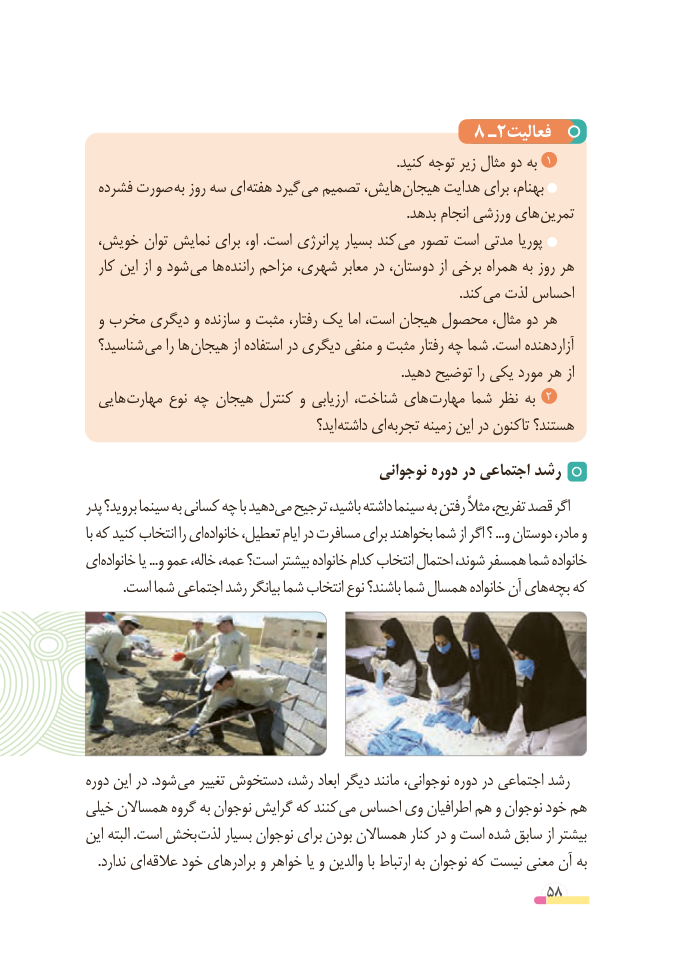

# PDF page 58

8 ـ2فعالیت
    .1کنید توجه زیر مثال دو به
  فشرده صورت به روز سه ای هفته گیرد می تصمیم هایش، هیجان هدایت برای بهنام،
                                                                                              .بدهد انجام ورزشی های تمرین
  خویش، توان نمایش برای او، .است پرانرژی بسیار کند می تصور است مدتی پوریا
  کار این از و شود می ها راننده مزاحم شهری، معابر در دوستان، از برخی همراه به روز هر
                           . کند می لذت احساس
  و مخرب دیگری و سازنده و مثبت رفتار، یک اما است، هیجان محصول مثال، دو هر
  شناسید؟ می را ها هیجان از استفاده در دیگری منفی و مثبت رفتار چه شما .است آزاردهنده
                                                                                             .دهید توضیح را یکی مورد هر از
  هایی مهارت نوع چه هیجان کنترل و ارزیابی شناخت، های مهارت شما نظر به  2
                                             اید؟ داشته ای تجربه زمینه این در تاکنون هستند؟

                                           نوجوانی دوره در اجتماعی رشد
پدر بروید؟ سینما به کسانی چه با دهید می ترجیح باشید، داشته سینما به رفتن مثالً تفریح، قصد اگر
با که کنید انتخاب را ای خانواده تعطیل، ایام در مسافرت برای بخواهند شما از اگر ؟ ...و دوستان مادر، و
ای خانواده یا ...و عمو خاله، عمه، است؟ بیشتر خانواده کدام انتخاب احتمال شوند، همسفر شما خانواده
. است شما اجتماعی رشد بیانگر شما انتخاب نوع باشند؟ شما همسال خانواده آن هایبچه که

دوره این در .شود می تغییر دستخوش رشد، ابعاد دیگر مانند نوجوانی، دوره در اجتماعی رشد
خیلی همساالن گروه به نوجوان گرایش که کنند می احساس وی اطرافیان هم و نوجوان خود هم
این  البته .است بخش لذت بسیار نوجوان برای بودن همساالن کنار در و است شده سابق از بیشتر
. ندارد ای عالقه خود برادرهای و خواهر یا و والدین با ارتباط به نوجوان که نیست معنی آن به
                                                          58

