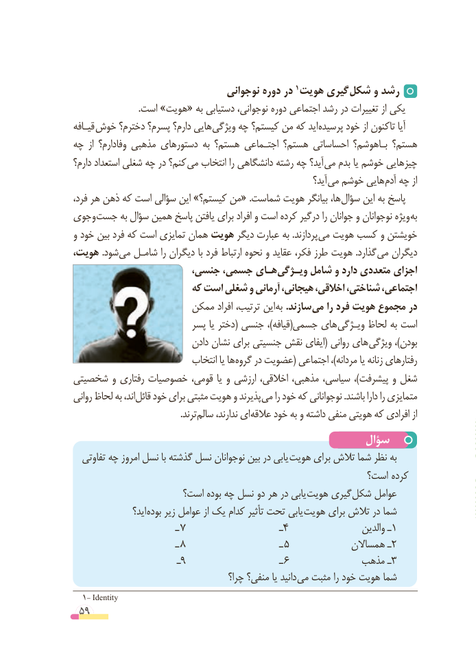

# PDF page 59

نوجوانی دوره در 1 هویت گیری ­شکل و رشد
                             .است »هویت« به دستیابی نوجوانی، دوره اجتماعی رشد در تغییرات از یکی
قیـافه خوش دخترم؟ پسرم؟ دارم؟ هایی ویژگی چه کیستم؟ من که اید پرسیده خود از تاکنون آیا
چه  از وفادارم؟ مذهبی دستورهای به هستم؟ اجتـماعی هستم؟ احساساتی بـاهوشم؟ هستم؟
دارم؟ استعداد شغلی چه در کنم؟ می انتخاب را دانشگاهی رشته چه آید؟ می بدم یا خوشم چیزهایی
                                                                   آید؟ می خوشم هایی آدم چه از
فرد، هر ذهن که است سؤالی این »کیستم؟ من« .شماست هویت بیانگر ها، سؤال این به پاسخ
جوی و جست به سؤال همین پاسخ یافتن برای افراد و است کرده درگیر را جوانان و نوجوانان ویژه ­به
و خود بین فرد که است تمایزی همان هویت دیگر عبارت به .پردازند­ می هویت کسب و خویشتن
هویت، .شود ­می شامـل را دیگران با فرد ارتباط نحوه و عقاید فکر، طرز هویت .گذارد ­می دیگران
                     جنسی، جسمی، هـای­ ویـژگی شامل و دارد متعددی اجزای
                        که است شغلی و آرمانی هیجانی، اخالقی، شناختی، اجتماعی،
                     ممکن افراد ترتیب، این به .سازند ­می را فرد هویت مجموع در
                         پسر یا دختر( جنسی ،)قیافه(جسمی های ­ویـژگی لحاظ به است
                             دادن نشان برای جنسیتی نقش ایفای( روانی های ویژگی ،)بودن
                            انتخاب یا ها ­گروه در عضویت( اجتماعی ،)مردانه یا زنانه رفتارهای
شخصیتی و رفتاری خصوصیات قومی، یا و ارزشی اخالقی، مذهبی، سیاسی، ،)پیشرفت و شغل
روانی لحاظ به اند، قائل خود برای مثبتی هویت و پذیرند ­می را خود که نوجوانانی .باشند دارا را متمایزی
                 .­ ترند سالم ندارند، ای ­عالقه خود به و داشته منفی هویتی که افرادی از
                                                سؤال
  تفاوتی چه امروز نسل با گذشته نسل نوجوانان بین در یابی هویت برای تالش شما نظر به
                                                        است؟ کرده
                     است؟ بوده چه نسل دو هر در یابی هویت گیری شکل عوامل
                 اید؟ بوده زیر عوامل از یک کدام تأثیر تحت یابی هویت برای تالش در شما
                          ـ 7                        ـ4                   والدین ـ 1
                          ـ 8                        ـ 5             همساالن ـ 2
                           ـ9                        ـ 6            مذهب ـ3
                                       چرا؟ منفی؟ یا دانید می مثبت را خود هویت شما
  1- Identity
 59

