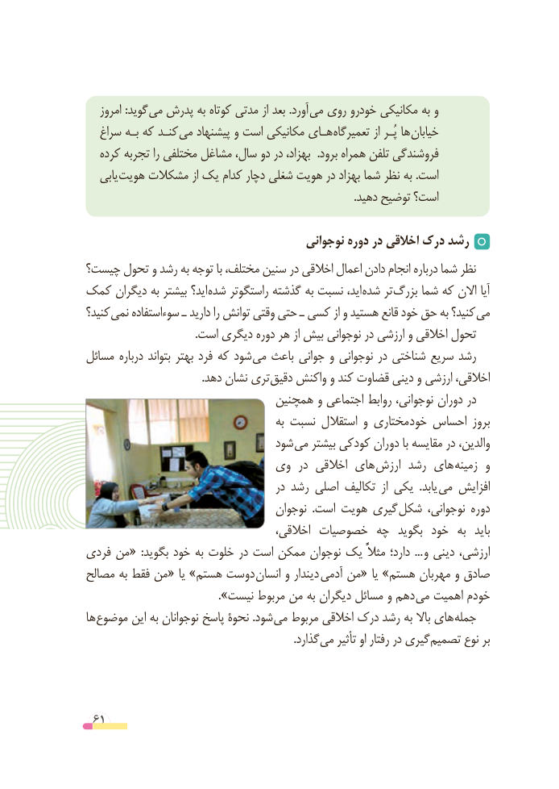

# PDF page 61

امروز :گوید می پدرش به کوتاه مدتی از بعد .آورد می روی خودرو مکانیکی به و
   سراغ بـه که کنـد می پیشنهاد و است مکانیکی هـای تعمیرگاه از پُـر ها خیابان
   کرده تجربه را مختلفی مشاغل سال، دو در بهزاد،  .برود همراه تلفن فروشندگی
   یابی هویت مشکالت از یک کدام دچار شغلی هویت در بهزاد شما نظر به .است
                                                                                                  .دهید توضیح است؟

                                        نوجوانی دوره در اخالقی درک رشد
چیست؟ تحول و رشد به توجه با مختلف، سنین در اخالقی اعمال دادن انجام درباره شما نظر
کمک دیگران به بیشتر اید؟ شده راستگوتر گذشته به نسبت اید، شده تر بزرگ شما که االن آیا
کنید؟ نمی سوءاستفاده ـ دارید را توانش وقتی حتی ـ کسی از و هستید قانع خود حق به کنید؟ می
                                        .است دیگری دوره هر از بیش نوجوانی در ارزشی و اخالقی تحول
مسائل درباره بتواند بهتر فرد که شود­ می باعث جوانی و نوجوانی در شناختی سریع رشد
                                          .دهد نشان تری ­دقیق واکنش و کند قضاوت دینی و ارزشی اخالقی،
                              همچنین و اجتماعی روابط نوجوانی، دوران در
                                           به نسبت استقالل و مختاری خود احساس بروز
                               شود می بیشتر کودکی دوران با مقایسه در والدین،
                         وی  در اخالقی های  ارزش رشد های ­زمینه و
                                       در رشد اصلی تکالیف  از یکی  .یابد می افزایش
                                    نوجوان  .است هویت گیری شکل نوجوانی، دوره
                                      اخالقی، خصوصیات چه  بگوید خود  به  باید
فردی من«  :بگوید خود به خلوت در است ممکن نوجوان یک مثالًً دارد؛  ... و دینی ارزشی،
مصالح به فقط من« یا »هستم دوست ­انسان و دیندار آدمی من« یا »هستم مهربان و صادق
   ». ­نیست مربوط من به دیگران مسائل و دهم می اهمیت خودم
ها موضوع این به نوجوانان پاسخ نحوة .شود می مربوط اخالقی درک رشد به باال های جمله
              . گذارد می تأثیر او رفتار در گیری تصمیم نوع بر

 61

