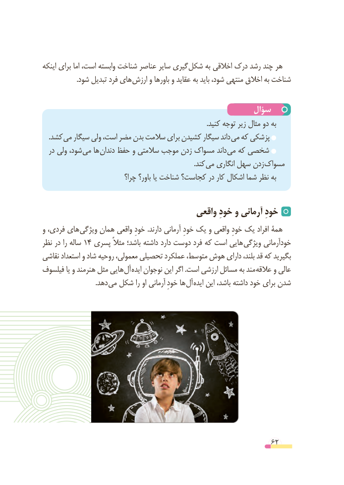

# PDF page 62

اینکه برای اما است، وابسته شناخت عناصر سایر گیری شکل به اخالقی درک رشد چند هر
                    .شود تبدیل فرد های ارزش و باورها و عقاید به باید شود، منتهی اخالق به شناخت

                                                سؤال
                                                                                                 .کنید توجه زیر مثال دو به
 . کشد می سیگار ولی است، مضر بدن سالمت برای کشیدن سیگار داند می که پزشکی
  در ولی شود، می ها دندان حفظ و سالمتی موجب زدن مسواک داند می که شخصی
                                                                                          .کند می انگاری سهل زدن مسواک
                            چرا؟ باور؟ یا شناخت کجاست؟ در کار اشکال شما نظر به

                                      واقعی خودِ و آرمانی خودِ
و فردی، های ویژگی همان واقعی  خودِهمة.دارند آرمانی خودِ یک و واقعی خودِ یک افراد
نظر در را ساله 14 پسری مثالً باشد؛ داشته دارد دوست فرد که است هایی ویژگی خودآرمانی
نقاشی استعداد و شاد روحیه معمولی، تحصیلی عملکرد متوسط، هوش دارای بلند، قد که بگیرید
فیلسوف یا و هنرمند مثل هایی آل ایده نوجوان این اگر .است ارزشی مسائل به مند عالقه و عالی
       . دهد می شکل را او آرمانی  خودِها آل ایده این باشد، داشته خود برای شدن

                                                          62

