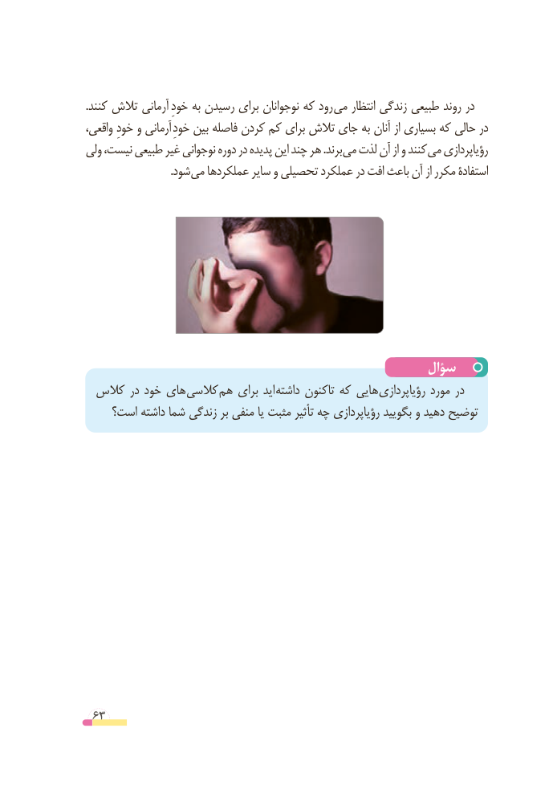

# PDF page 63

.کنند تالش آرمانی خودِرودبه رسیدن برای نوجوانان که      می انتظار زندگی طبیعی روند در
واقعی، خودِ و آرمانی خودِدربین فاصله کردن کم برای تالش جای به آنان از بسیاری که حالی
ولی نیست، طبیعی غیر نوجوانی دوره در پدیده این چند هر .برند می لذت آن از و کنند می رؤیاپردازی
       . شود می عملکردها سایر و تحصیلی عملکرد در افت باعث آن از مکرر استفادة

                                                سؤال
 کالس در خود های کالسی هم برای اید داشته تاکنون که هایی رؤیاپردازی مورد در
    است؟ داشته شما زندگی بر منفی یا مثبت تأثیر چه رؤیاپردازی بگویید و دهید توضیح

 63

