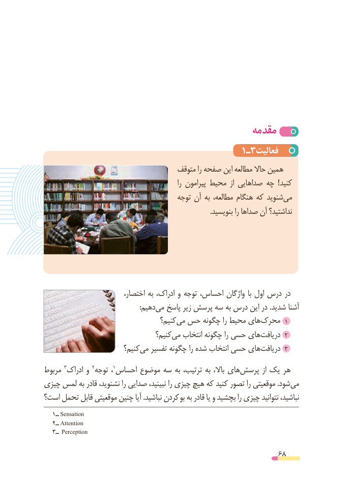

# PDF page 68

مقدمه
                                     1ـ3فعالیت
                                    متوقف را صفحه این مطالعه حاال همین
                                                               را پیرامون محیط  از صداهایی چه  ! کنید
                                       توجه آن به مطالعه، هنگام که شنویدمی‌
                                                                                                .بنویسید را صداها آن نداشتید؟

                           اختصار، به ادراک، و توجه احساس، واژگان  با اول درس در
          :‌دهیممی پاسخ زیر پرسش سه به درس این در .شدید آشنا
                                    کنیم؟می‌ حس چگونه‌        را محیط هایمحرک‌       1
                                  کنیم؟می‌   انتخاب چگونه را حسی هایدریافت‌2
                         کنیم؟می‌   تفسیر چگونه را شده انتخاب حسی هایدریافت‌3
مربوط 3ادراک و 2توجه  ،1احساس موضوع سه به ترتیب، به باال، هایپرسش‌         از یک هر
چیزی لمس به قادر نشنوید، را صدایی نبینید، را چیزی هیچ که کنید تصور را موقعیتی .شودمی‌
است؟ تحمل قابل موقعیتی چنین آیا .نباشید کردن بو به قادر یا و بچشید را چیزی نتوانید نباشید،
   1ــ Sensation
   2ــ Attention
   3ــ Perception

                                                          68

