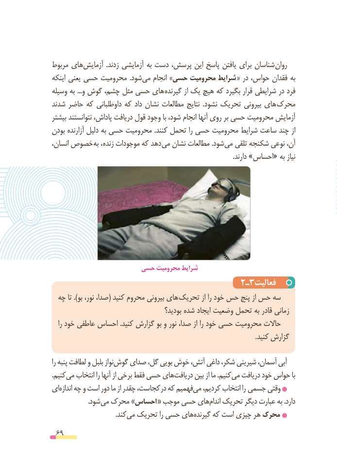

# PDF page 69

مربوط هایآزمایش‌            .زدند آزمایشی به دست پرسش، این پاسخ یافتن برای شناسان روان
اینکه یعنی حسی محرومیت  .شودمی‌   انجام »حسی محرومیت شرایط « در حواس، فقدان به
وسیله به ...و گوش چشم، مثل حسی های گیرنده از یک هیچ که بگیرد قرار شرایطی در فرد
شدند حاضر که داوطلبانی که داد نشان مطالعات نتایج  .نشود تحریک بیرونی های محرک
بیشتر نتوانستند پاداش، دریافت قول وجود با شود، انجام آنها روی بر حسی محرومیت آزمایش
بودن آزارنده دلیل به حسی محرومیت .کنند تحمل را حسی محرومیت شرایط ساعت چند از
انسان، خصوص به ، زنده موجودات که دهد می نشان مطالعات .شود می تلقی شکنجه نوعی آن،
                                                                                                              .دارند »احساس« به نیاز

                   حسی محرومیت شرایط
                                     2ـ3فعالیت
  چه تا ).بو نور، صدا،( کنید محروم بیرونی های  تحریک از را خود حس پنج از حس سه
                                        بودید؟ شده ایجاد وضعیت تحمل به قادر زمانی
   را خود عاطفی احساس .کنید گزارش بو و نور صدا، از را خود حسی محرومیت حاالت
                                                                                                           . کنید گزارش

را پنبه لطافت و بلبل نوازگوش‌   صدای گل، بویی خوش آتش، داغی شکر، شیرینی آسمان، آبی
.‌کنیممی انتخاب را آنها از برخی فقط حسی هایدریافت‌      بین از ما .کنیممی‌  دریافت خود حواس با
ایاندازه‌   چه و است دور ما از چقدر کجاست، در که فهمیممی‌   کردیم، انتخاب را جسمی وقتی
                      .شود می محرک »احساس « موجب حسی هایاندام‌   تحریک دیگر عبارت به .دارد
                                       .کندمی‌  تحریک را حسی هایگیرنده‌     که است چیزی هر محرک
 69

