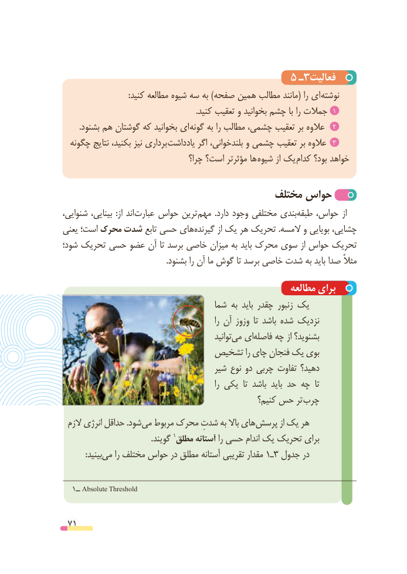

# PDF page 71

5 ـ3فعالیت
 : کنید مطالعه شیوه سه به )صفحه همین مطالب مانند( را ای نوشته
  .1کنید تعقیب و بخوانید چشم با را جمالت
        .بشنود هم گوشتان که بخوانید ای  2گونه به را مطالب چشمی، تعقیب بر عالوه
  چگونه نتایج بکنید، نیز برداری  یادداشت اگر بلندخوانی، و چشمی تعقیب بر عالوه   3
                                    چرا؟ است؟ مؤثرتر ها شیوه از یک کدام بود؟ خواهد

                                      مختلف حواس
،اندشنوایی بینایی،  :از     عبارت حواس ترین مهم  .دارد وجود مختلفی بندیطبقه‌    حواس، از
یعنی است؛ محرک شدت تابع حسی هایگیرنده‌        از یک هر تحریک .المسه و بویایی چشایی،
شود؛ تحریک حسی عضو آن تا برسد خاصی میزان به باید محرک سوی از حواس تحریک
                                                    .بشنود را آن ما گوش تا برسد خاصی شدت به باید صدا مثالً

                                                      مطالعه برای
                                     شما به باید چقدر زنبور یک
                                                              را آن وزوز  تا باشد شده نزدیک
                                                     توانیدمی‌  ایفاصله‌    چه از بشنوید؟
                          تشخیص را چای فنجان یک بوی
                                     شیر نوع دو چربی تفاوت دهید؟
                                                              را یکی  تا باشد  باید حد چه  تا
                                                    کنیم؟ حس تر چرب
 الزم انرژی حداقل .شودمی‌  مربوط محرک شدتِ به باال هایپرسش‌         از یک هر
       .1گویند مطلق آستانه را حسی اندام یک تحریک برای
  :‌بینیدمی را مختلف حواس در مطلق آستانه تقریبی مقدار 13ـ جدول در

   1ــ Absolute Threshold

 71

