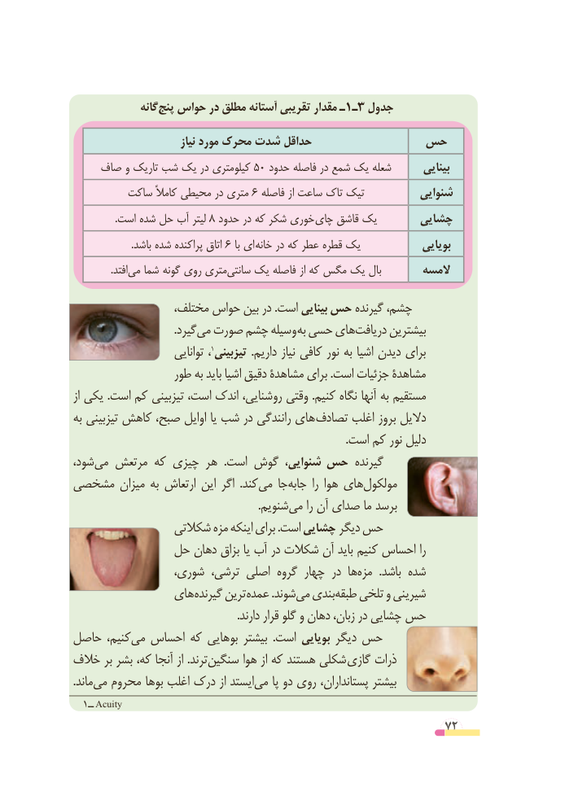

# PDF page 72

گانهپنج‌  حواس در مطلق آستانه تقریبی مقدار ـ1ـ3 جدول

                            نیاز مورد محرک شدت حداقل          حس
    صاف و تاریک شب یک در کیلومتری 50 حدود فاصله در شمع یک شعله       بینایی
         ساکت کامالً محیطی در متری 6 فاصله از ساعت تاک تیک          شنوایی
 .8است شده حل آب لیتر  حدود در که شکر خوری چای قاشق یک      چشایی
                        .باشد شده پراکنده اتاق ٦ با ای  خانه در که عطر قطره یک             بویایی
    .‌افتدمی شما گونه روی متری ‌سانتی یک فاصله از که مگس یک بال       المسه
                 مختلف، حواس بین در .است بینایی حس گیرنده چشم،
                                    .گیردمی‌  صورت چشم وسیله به حسی هایدریافت‌      بیشترین
                        توانایی ،                                        1تیزبینی  .داریم نیاز کافی نور به اشیا دیدن برای
                 طور به باید اشیا دقیق مشاهدۀ برای .است جزئیات مشاهدۀ
از یکی .است کم تیزبینی است، اندک ،روشنایی‌       وقتی .کنیم نگاه آنها به مستقیم
به تیزبینی کاهش صبح، اوایل یا شب در رانندگی های تصادف اغلب بروز دالیل
                                                                                                  .است کم نور دلیل
شود،می‌   مرتعش که چیزی هر  .است گوش شنوایی، حس گیرنده
مشخصی میزان به ارتعاش این اگر  .کندمی‌   جاجابه‌      را هوا هایمولکول‌
           .‌شنویممی را آن صدای ما برسد
                شکالتی مزه اینکه برای .است چشایی دیگر حس
             حل دهان بزاق یا آب در شکالت آن باید کنیم احساس را
                 شوری، ترشی، اصلی گروه چهار در هامزه‌      .باشد شده
               های گیرنده ترین عمده .شوندمی‌  بندیطبقه‌   تلخی و شیرینی
  . دارند قرار گلو و دهان زبان، در چشایی حس
حاصل کنیم،می‌  احساس که بوهایی بیشتر  .است بویایی دیگر حس
خالف بر بشر که، آنجا از .ترندسنگین‌       هوا از که هستند شکلی گازی ذرات
.ماندمی‌  محروم بوها اغلب درک از ایستدمی‌    پا دو روی پستانداران، بیشتر
  1ــ Acuity
                                                          72

