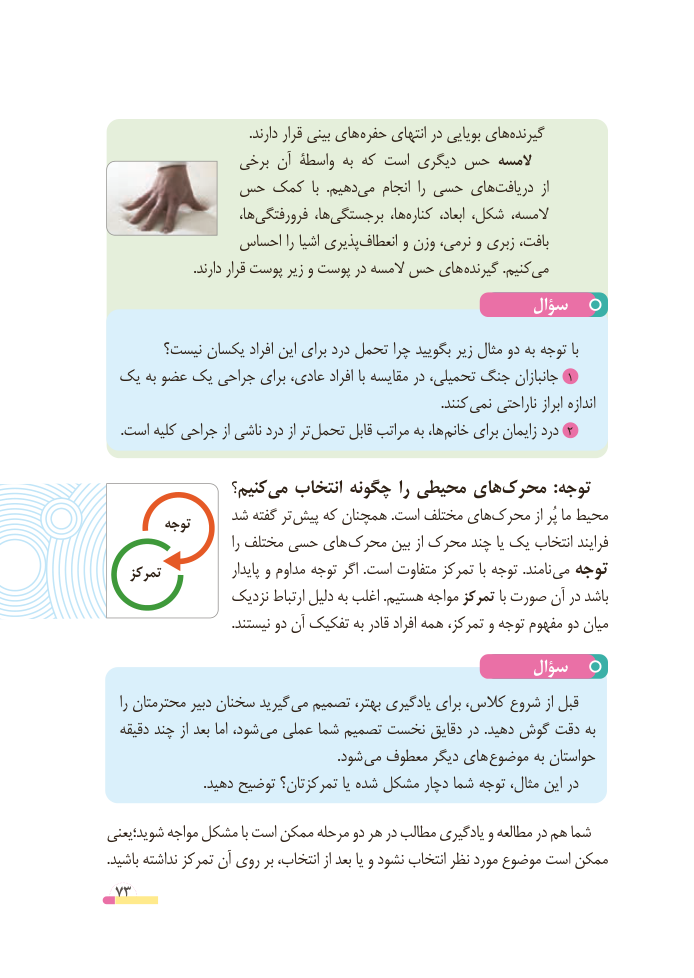

# PDF page 73

.دارند قرار بینی های حفره انتهای در بویایی هایگیرنده‌
                  برخی آن واسطۀ به که است دیگری حس المسه
          حس کمک  با  .دهیممی‌    انجام  را حسی هایدریافت‌          از
                         ها،فرورفتگی‌           ها،برجستگی‌           ها،کناره‌       ابعاد، شکل، المسه،
                احساس را اشیا پذیریانعطاف‌      و وزن نرمی، و زبری بافت،
 . دارند قرار پوست زیر و پوست در المسه حس های گیرنده .کنیممی‌
                                                سؤال
       نیست؟ یکسان افراد این برای درد تحمل چرا بگویید زیر مثال دو به توجه با
 یک به عضو یک جراحی برای عادی، افراد با مقایسه در تحمیلی، جنگ جانبازان 1
                                                                                                  .کنند  نمی ناراحتی ابراز اندازه
. است کلیه جراحی از ناشی درد از تر تحمل قابل مراتب به ها، 2خانم برای زایمان درد

                 کنیم؟می‌   انتخاب چگونه را محیطی هایمحرک‌          :توجه
               شد گفته تر پیش که همچنان .است مختلف هایمحرک‌         از پُر ما محیط         توجه
                              را مختلف حسی های محرک بین از محرک چند یا یک انتخاب فرایند
    تمرکز               پایدار و مداوم توجه اگر .است متفاوت تمرکز با توجه .نامند می توجه
                 نزدیک ارتباط دلیل به اغلب .هستیم مواجه تمرکز با صورت آن در باشد
                                     .نیستند دو آن تفکیک به قادر افراد همه تمرکز، و توجه مفهوم دو میان
                                                سؤال
   را محترمتان دبیر سخنان گیرید  می تصمیم بهتر، یادگیری برای کالس، شروع از قبل
  دقیقه چند از بعد اما شود، می عملی شما تصمیم نخست دقایق در .دهید گوش دقت به
               . شود می معطوف دیگر های موضوع به حواستان
                            .دهید توضیح تمرکزتان؟ یا شده مشکل دچار شما توجه مثال، این در
شوید؛یعنی مواجه مشکل با است ممکن مرحله دو هر در مطالب یادگیری و مطالعه در هم شما
.باشید نداشته تمرکز آن روی بر انتخاب، از بعد یا و نشود انتخاب نظر مورد موضوع است ممکن
 73

