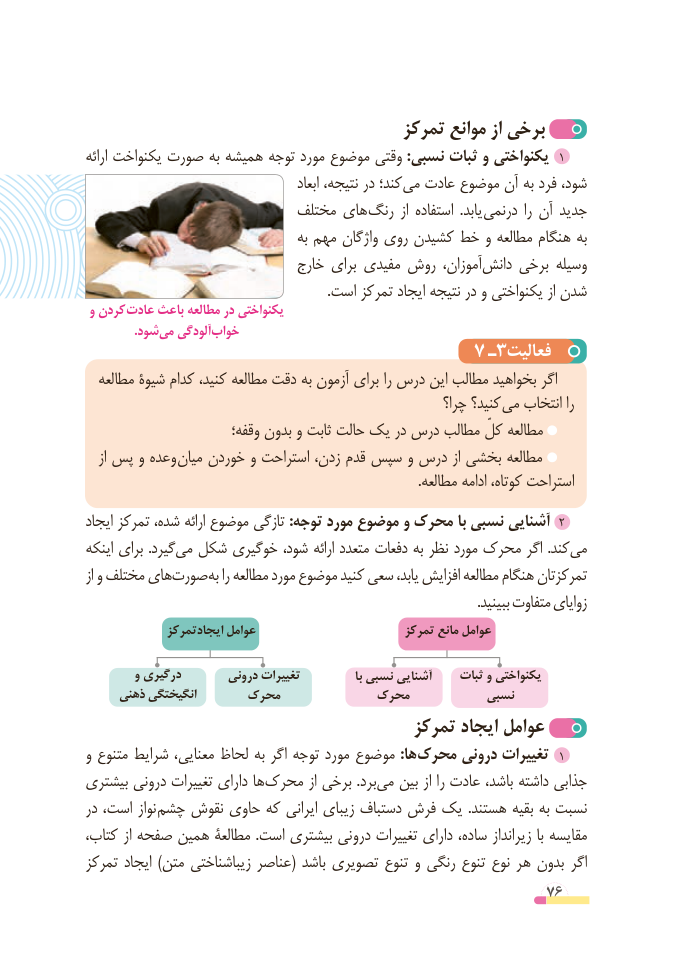

# PDF page 76

تمرکز موانع از برخی
ارائه یکنواخت صورت به همیشه توجه مورد موضوع وقتی :نسبی ثبات و یکنواختی  1
                                                ابعاد نتیجه، در کند؛می‌  عادت موضوع آن به فرد شود، ‌
                           مختلف های رنگ  از استفاده  .یابد درنمی  را آن جدید
                                      به مهم واژگان روی کشیدن خط و مطالعه هنگام به
                               خارج برای مفیدی روش آموزان،دانش‌    برخی وسیله
                                                                       .است تمرکز ایجاد نتیجه در و یکنواختی از شدن
 و کردن عادت باعث مطالعه در یکنواختی
   .‌شودمی آلودگیخواب‌
                                      ٧ ـ3فعالیت
  مطالعه شیوة کدام کنید، مطالعه دقت به آزمون برای را درس این مطالب بخواهید اگر
                                                            چرا؟ کنید؟ می انتخاب را
                          وقفه؛ بدون و ثابت حالت یک در درس مطالب کلّ مطالعه
   از پس و وعده میان خوردن و استراحت زدن، قدم سپس و درس از بخشی مطالعه
                                                                                                  .مطالعه ادامه کوتاه، استراحت
ایجاد تمرکز شده، ارائه موضوع تازگی :توجه مورد موضوع و محرک با نسبی آشنایی  2
اینکه برای .گیردمی‌  شکل خوگیری شود، ارائه متعدد دفعات به نظر مورد محرک اگر .کندمی‌
از و مختلف هایصورت‌        به را مطالعه مورد موضوع کنید سعی یابد، افزایش مطالعه هنگام تمرکزتان
                                                                                                                   .ببینید متفاوت زوایای
              ایجادتمرکز عوامل                         تمرکز مانع عوامل

         و درگیری        درونی تغییرات               با نسبی آشنایی     ثبات و یکنواختی
     ذهنی انگیختگی      محرک            محرک           نسبی
                                       تمرکز ایجاد عوامل
و متنوع شرایط معنایی، لحاظ به اگر توجه مورد موضوع :ها محرک درونی تغییرات  1
بیشتری درونی تغییرات دارای ها‌محرک از برخی .بردمی‌   بین از را عادت باشد، داشته جذابی
در است، نواز چشم نقوش حاوی که ایرانی زیبای دستباف فرش یک  .هستند بقیه به نسبت
کتاب، از صفحه همین مطالعة .است بیشتری درونی تغییرات دارای ساده، زیرانداز با مقایسه
تمرکز ایجاد )متن زیباشناختی عناصر( باشد تصویری تنوع و رنگی تنوع نوع هر بدون اگر
                                                          76

