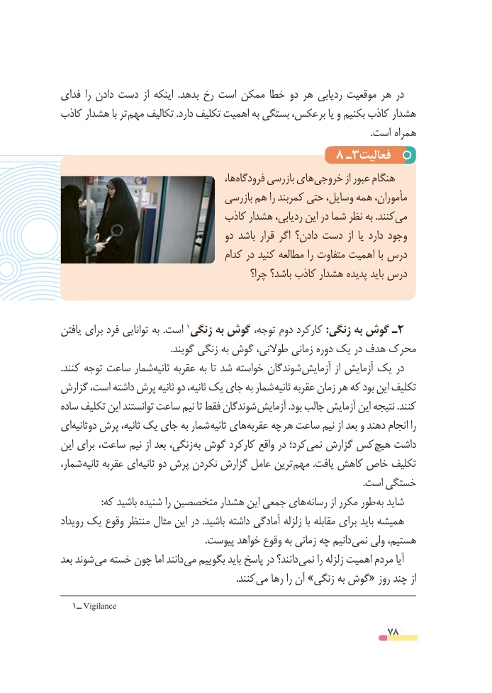

# PDF page 78

فدای را دادن دست از اینکه  .بدهد رخ است ممکن خطا دو هر ردیابی موقعیت هر در
کاذب هشدار با تر مهم تکالیف .دارد تکلیف اهمیت به بستگی برعکس، یا و بکنیم کاذب هشدار
                          . است همراه
                                      ٨ ـ3فعالیت
                                            ها،فرودگاه‌      بازرسی هایخروجی‌         از عبور هنگام
                                   بازرسی هم را کمربند حتی وسایل، همه مأموران،
                               کاذب هشدار ردیابی، این در شما نظر به .کنندمی‌
                                     دو باشد قرار اگر دادن؟ دست  از  یا دارد وجود
                                     کدام در کنید مطالعه را متفاوت اهمیت با درس
                                             چرا؟ باشد؟ کاذب هشدار پدیده باید درس

یافتن برای فرد توانایی به .است 1زنگی٢به گوش توجه، دوم کارکرد :زنگی به گوش ـ
                                              .گویند زنگی به گوش طوالنی، زمانی دوره یک در هدف محرک
.کنند توجه ساعت شمارثانیه‌    عقربه به تا شد خواسته شوندگان آزمایش از آزمایش یک در
گزارش است، داشته پرش ثانیه دو ثانیه، یک جای به شمار ثانیه عقربه زمان هر که بود این تکلیف
ساده تکلیف این توانستند ساعت نیم تا فقط شوندگان آزمایش .بود جالب آزمایش این نتیجه .کنند
ایدوثانیه‌    پرش ثانیه، یک جای به شمار ثانیه هایعقربه‌    چه هر ساعت نیم از بعد و دهند انجام را
این برای ، ساعت  نیم از بعد زنگی، به گوش کارکرد واقع در کرد؛نمی‌   گزارش کس هیچ داشت
شمار، ثانیه عقربه ای ثانیه دو پرش نکردن گزارش عامل ترین مهم .یافت کاهش خاص تکلیف
                                                                                                                             .است خستگی
                 :که باشید شنیده را متخصصین هشدار این جمعی های رسانه از مکرر طور به شاید
رویداد یک وقوع منتظر مثال این در .باشید داشته آمادگی زلزله با مقابله برای باید همیشه
  . پیوست خواهد وقوع به زمانی چه دانیم نمی ولی هستیم،
بعد شوند می خسته چون اما دانند می بگوییم باید پاسخ در دانند؟ نمی را زلزله اهمیت مردم آیا
                . کنند می رها را آن »زنگی به گوش« روز چند از
   1ــ Vigilance
                                                          78

