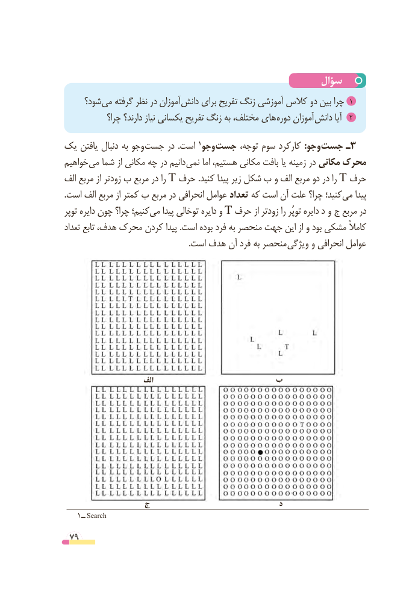

# PDF page 79

سؤال
     شود؟ می گرفته نظر در آموزان دانش برای تفریح زنگ آموزشی کالس دو بین چرا 1
            چرا؟ دارند؟ نیاز یکسانی تفریح زنگ به مختلف، های دوره آموزان 2دانش آیا
یک یافتن دنبال به وجو جست در  .است                                          1وجو جست توجه، سوم کارکرد :وجو جست٣ـ
خواهیم می شما از مکانی چه در دانیم نمی اما هستیم، مکانی بافت یا زمینه در مکانی محرک
الف مربع از زودتر ب مربع در را T حرف .کنید پیدا زیر شکل ب و الف مربع دو در را T حرف
.است الف مربع از کمتر ب مربع در انحرافی عوامل تعداد که است آن علت چرا؟ کنید؛می‌    پیدا
توپر دایره چون چرا؟ کنیم؛می‌    پیدا توخالی دایره و T حرف از زودتر را توپُر دایره د و ج مربع در
تعداد تابع هدف، محرک کردن پیدا .است بوده فرد به منحصر جهت این از و بود مشکی کامالً
  . است هدف آن فرد به منحصر ویژگی و انحرافی عوامل

                        الف                  ب

               ج                                      د
    1ــ Search
 79

