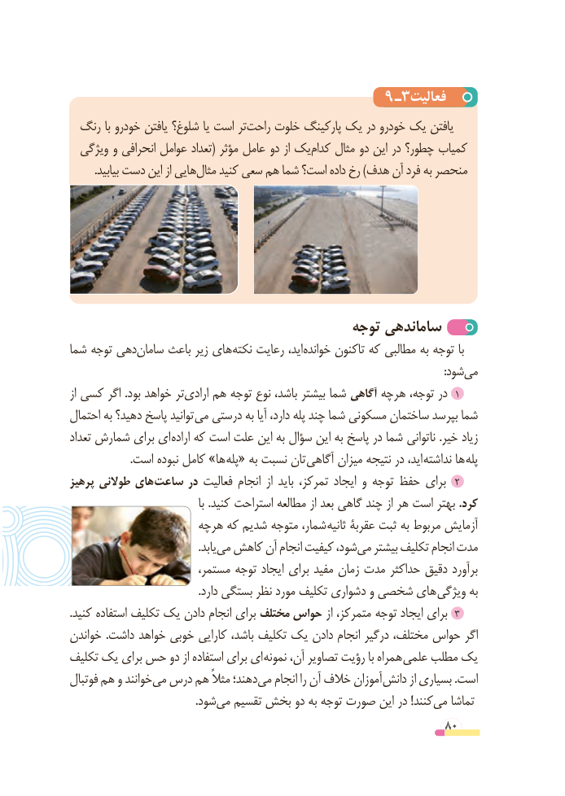

# PDF page 80

٩ ـ3فعالیت
  رنگ با خودرو یافتن شلوغ؟ یا است ترراحت‌    خلوت پارکینگ یک در خودرو یک یافتن
  ویژگی و انحرافی عوامل تعداد( مؤثر عامل دو از یککدام‌    مثال دو این در چطور؟ کمیاب
.‌بیابید دست این از هاییمثال کنید سعی هم شما است؟ داده رخ )هدف آن فرد به منحصر

                                       توجه ساماندهی
شما توجه دهیسامان‌     باعث زیر های نکته رعایت اید، خوانده تاکنون که مطالبی به توجه با
                               :‌شودمی
از کسی اگر .بود خواهد ترارادی‌   هم توجه نوع باشد، بیشتر شما آگاهی هرچه توجه، در  1
احتمال به دهید؟ پاسخ توانید می درستی به آیا دارد، پله چند شما مسکونی ساختمان بپرسد شما
تعداد شمارش برای ای اراده که است علت این به سؤال این به پاسخ در شما ناتوانی .خیر زیاد
 . است نبوده کامل »ها پله« به نسبت تان آگاهی میزان نتیجه در اید، نداشته ها پله
پرهیز طوالنی های 2ساعت در فعالیت انجام  از باید تمرکز، ایجاد و توجه حفظ برای
                                          با .کنید استراحت مطالعه از بعد گاهی چند از هر است بهتر .کرد
                     هرچه که شدیم متوجه شمار، ثانیه عقربۀ ثبت به مربوط آزمایش
                                              .یابدمی‌  کاهش آن انجام کیفیت شود،می‌   بیشتر تکلیف انجام مدت
                        مستمر، توجه ایجاد برای مفید زمان مدت حداکثر دقیق برآورد
 . دارد بستگی نظر مورد تکلیف دشواری و شخصی های ویژگی به
.کنید استفاده تکلیف یک دادن انجام برای مختلف حواس از متمرکز، توجه ایجاد برای  3
خواندن .داشت خواهد خوبی کارایی باشد، تکلیف یک دادن انجام درگیر مختلف، حواس اگر
تکلیف یک برای حس دو از استفاده برای ای نمونه آن، تصاویر رؤیت با همراه علمی مطلب یک
فوتبال هم و خوانندمی‌  درس هم مثالً دهند؛می‌   انجام را آن خالف آموزاندانش‌       از بسیاری .است
          .‌شودمی تقسیم بخش دو به توجه صورت این در !کنندمی‌   تماشا
                                                          80

