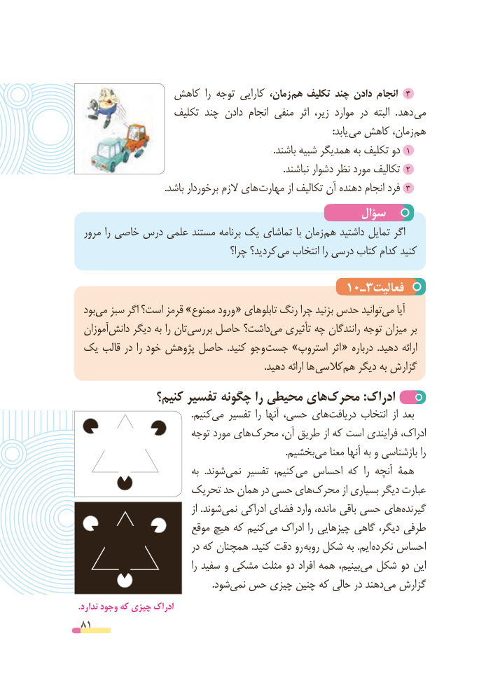

# PDF page 81

کاهش  را توجه کارایی زمان، 4هم تکلیف چند دادن انجام
                   تکلیف چند دادن انجام منفی  اثر  زیر، موارد در  البته  . دهد می
                           : یابد می کاهش زمان، هم
                                                                                  .باشند شبیه همدیگر به تکلیف دو 1
   .2نباشند دشوار نظر مورد تکالیف
                                    .باشد برخوردار الزم های 3مهارت از تکالیف آن دهنده انجام فرد
                                              سؤال
 مرور را خاصی درس علمی مستند برنامه یک تماشای با زمان هم داشتید تمایل اگر
                                    چرا؟ کردید؟ می انتخاب را درسی کتاب کدام کنید

                                     10ـ3فعالیت
 بودمی‌  سبز اگر است؟ قرمز »ممنوع ورود « تابلوهای رنگ چرا بزنید حدس توانیدمی‌    آیا
 آموزاندانش‌     دیگر به را تانبررسی‌    حاصل داشت؟می‌   تأثیری چه رانندگان توجه میزان بر
 یک قالب در را خود پژوهش حاصل  .کنید وجو جست »استروپ اثر « درباره  .دهید ارائه
       . دهید ارائه ها کالسیهم‌   دیگر به گزارش
              کنیم؟ تفسیر چگونه را محیطی هایمحرک‌          :ادراک
                                               .کنیممی‌   تفسیر  را آنها حسی، هایدریافت‌      انتخاب  از بعد
                        توجه مورد های محرک آن، طریق از که است فرایندی ادراک،
             .‌بخشیممی معنا آنها به و بازشناسی را
                             به  .شوندنمی‌    تفسیر کنیم، می احساس که  را آنچه همۀ
                   تحریک حد همان در حسی هایمحرک‌         از بسیاری دیگر عبارت
                                       از .شوندنمی‌    ادراکی فضای وارد مانده، باقی حسی هایگیرنده‌
                        موقع هیچ که کنیممی‌   ادراک را چیزهایی گاهی دیگر، طرفی
                           در که همچنان .کنید دقت رو روبه شکل به .ایم نکرده احساس
                                       را سفید و مشکی مثلث دو افراد همه بینیم،می‌  شکل دو این
             .‌شودنمی حس چیزی چنین که حالی در دهندمی‌  گزارش
.ندارد وجود که چیزی ادراک
81

