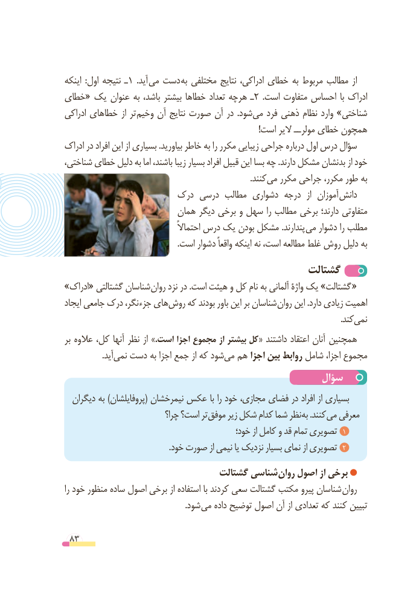

# PDF page 83

اینکه  :اول نتیجه ـ1  .آید می دست به مختلفی نتایج ادراکی، خطای به مربوط مطالب از
خطای« یک عنوان به باشد، بیشتر خطاها تعداد هرچه ـ 2  .است متفاوت احساس  با ادراک
ادراکی خطاهای از تر وخیم آن نتایج صورت آن در  .شودمی‌   فرد ذهنی نظام وارد »شناختی
                                                                                            !است الیر مولرــ خطای همچون
ادراک در افراد این از بسیاری .بیاورید خاطر به را مکرر زیبایی جراحی درباره اول درس سؤال
شناختی، خطای دلیل به اما باشند، زیبا بسیار افراد قبیل این بسا چه .دارند مشکل بدنشان از خود
                   .‌کنندمی مکرر جراحی مکرر، طور به
                     درک درسی مطالب دشواری درجه  از  آموزان دانش
                         همان دیگر برخی و سهل را مطالب برخی دارند؛ متفاوتی
                                       احتماالً درس یک بودن مشکل .پندارند می دشوار را مطلب
                                                       .است دشوار واقعاً اینکه نه است، مطالعه غلط روش دلیل به
                                             گشتالت
»ادراک« گشتالتی شناسان روان نزد در .است هیئت و کل نام به آلمانی واژۀ یک »گشتالت «
ایجاد جامعی درک نگر، جزء هایروش‌    که بودند باور این بر شناسان روان این .دارد زیادی اهمیت
                                  .‌کندنمی
بر عالوه کل، آنها نظر از .»است اجزا مجموع از بیشتر کل« داشتند اعتقاد آنان همچنین
     .‌آیدنمی دست به اجزا جمع از که شودمی‌  هم اجزا بین روابط شامل اجزا، مجموع
                                                سؤال
  دیگران به )پروفایلشان( نیمرخشان عکس با را خود مجازی، فضای در افراد از بسیاری
                             چرا؟ است؟ تر موفق زیر شکل کدام شما نظر به .کنند می معرفی
                                              خود؛ از کامل و قد تمام تصویری  1
                                              . خود صورت از نیمی یا نزدیک بسیار نمای از تصویری  2
                                گشتالت شناسی روان اصول از برخی
را خود منظور ساده اصول برخی از استفاده با کردند سعی گشتالت مکتب پیرو شناسان روان
             . شود می داده توضیح اصول آن از تعدادی که کنند تبیین

 83

