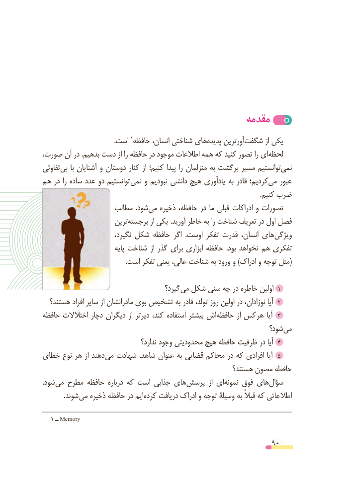

# PDF page 90

مقدمه
                                          .است 1حافظه انسان، شناختی هایپدیده‌     آورترینشگفت‌         از یکی
صورت، آن در .بدهیم دست از را حافظه در موجود اطالعات همه که کنید تصور را ایلحظه‌
تفاوتیبی‌    با آشنایان و دوستان کنار از کنیم؛ پیدا را منزلمان به برگشت مسیر توانستیمنمی‌
هم در را ساده عدد دو توانستیم نمی و نبودیم دانشی هیچ یادآوری به قادر کردیم؛می‌   عبور
                                                                                                                                 .کنیم ضرب
                    مطالب  .شودمی‌   ذخیره حافظه، در ما قبلی ادراکات و تصورات
                      ترینبرجسته‌          از یکی .آورید خاطر به را شناخت تعریف در اول فصل
                          نگیرد، شکل حافظه اگر  .اوست تفکر قدرت انسان، هایویژگی‌
                             پایه شناخت از گذر برای ابزاری حافظه  .بود نخواهد هم تفکری
                                                 .است تفکر یعنی عالی، شناخت به ورود و )ادراک و توجه مثل(

                                        گیرد؟ می شکل سنی چه در خاطره اولین 1
  هستند؟ افراد سایر از مادرانشان بوی تشخیص به قادر تولد، روز اولین در نوزادان، آیا 2
حافظه اختالالت دچار دیگران از دیرتر کند، استفاده بیشتر اش حافظه از کس هر آیا  3
                                                                 شود؟می‌
                                      ندارد؟ وجود محدودیتی هیچ‌   حافظه ظرفیت در آیا 4
خطای نوع هر از دهند می شهادت شاهد، عنوان به قضایی محاکم در که افرادی آیا  5
                                                       هستند؟ مصون حافظه
.‌شودمی مطرح حافظه درباره که است جذابی هایپرسش‌          از اینمونه‌    فوق هایسؤال‌
  . شوند می ذخیره حافظه در ایم کرده دریافت ادراک و توجه وسیلۀ به قبالً که اطالعاتی

   1 ــ Memory

                                                          90

