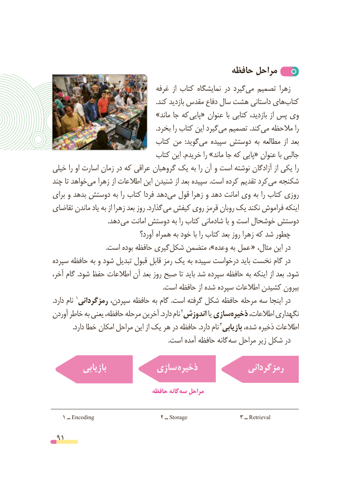

# PDF page 91

حافظه مراحل
                               غرفه  از کتاب نمایشگاه در گیردمی‌   تصمیم زهرا
                                                              .کند بازدید مقدس دفاع سال هشت داستانی هایکتاب‌
                         »ماند جا که پایی« عنوان با کتابی بازدید، از پس وی
                                                              .بخرد را کتاب این گیردمی‌  تصمیم .کندمی‌  مالحظه را
                             کتاب من  :گویدمی‌   سپیده دوستش به مطالعه  از بعد
                             کتاب این .خریدم را »ماند جا که پایی« عنوان با جالبی
خیلی را او اسارت زمان در که عراقی گروهبان یک به را آن و است نوشته آزادگان از یکی را
چند تا خواهدمی‌   زهرا از اطالعات این شنیدن از بعد سپیده .است کرده تقدیم کردمی‌  شکنجه
برای و بدهد دوستش به را کتاب فردا دهدمی‌  قول زهرا و دهد امانت وی به را کتاب روزی
تقاضای ماندن یاد به از زهرا بعد روز .گذارد می کیفش روی قرمز روبان یک نکند فراموش اینکه
                                 .دهد می امانت دوستش به را کتاب شادمانی با و است خوشحال دوستش
                                آورد؟ همراه به خود با را کتاب بعد روز زهرا که شد چطور
  .‌است بوده حافظه گیریشکل متضمن ،»وعده به عمل « ،درمثال این
سپرده حافظه به و شود تبدیل قبول قابل رمز یک به سپیده درخواست باید نخست گام در
آخر، گام .شود حفظ اطالعات آن بعد روز صبح تا باید شد سپرده حافظه به اینکه از بعد .شود
                                                                  .است حافظه از شده سپرده اطالعات کشیدن بیرون
.دارد نام 1رمزگردانی سپردن، حافظه به گام .است گرفته شکل حافظه مرحله سه اینجا در
آوردن خاطر به یعنی حافظه، مرحله آخرین .دارد نام 2اندوزش یا سازیذخیره‌     اطالعات، نگهداری
.3دارد خطا امکان مراحل این از یک هر در حافظه .دارد نام بازیابی شده، ذخیره اطالعات
                                                                     .است آمده حافظه گانه سه مراحل زیر شکل در

         بازیابی          سازی ذخیره             گردانی رمز

                                حافظه گانهسه‌   مراحل

   1 ــ Encoding                     2 ــ Storage                 3 ــ Retrieval

 91

