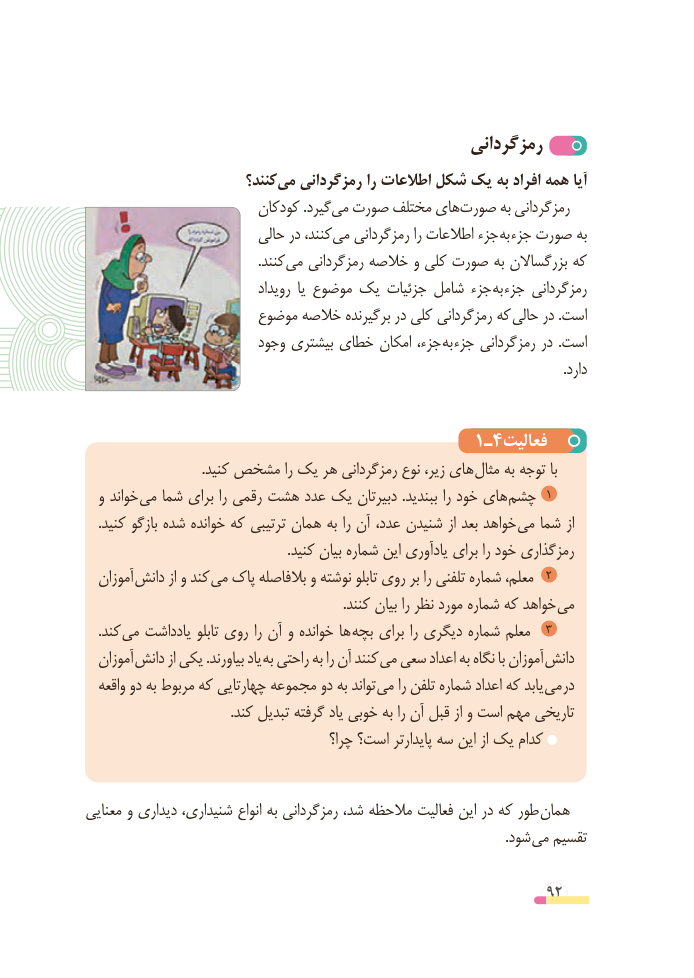

# PDF page 92

رمزگردانی
                         کنند؟‌می رمزگردانی را اطالعات شکل یک به افراد همه آیا
                         کودکان .گیردمی‌  صورت مختلف هایصورت‌      به رمزگردانی
                          حالی در کنند،می‌   رمزگردانی را اطالعات جزء به جزء صورت به
                                                   .کنندمی‌   رمزگردانی خالصه و کلی صورت به بزرگساالن که
                                رویداد  یا موضوع یک جزئیات شامل جزء به جزء رمزگردانی
                      موضوع خالصه برگیرنده در کلی رمزگردانی که حالی در .است
                         وجود بیشتری خطای امکان جزء، به جزء رمزگردانی در  .است
                                                                                                                                            .دارد

                                      1ـ4فعالیت
 . کنید مشخص را یک هر رمزگردانی نوع زیر، های مثال به توجه با
  و خواند می شما برای را رقمی هشت عدد یک دبیرتان  .ببندید را خود های چشم  ١
    .کنید بازگو شده خوانده که ترتیبی همان به را آن عدد، شنیدن از بعد خواهد می شما از
                                                           .کنید بیان شماره این یادآوری برای را خود رمزگذاری
  آموزان دانش از و کند می پاک بالفاصله و نوشته تابلو روی بر را تلفنی شماره معلم،  ٢
                                                                            .کنند بیان را نظر مورد شماره که خواهد می
    .کند می یادداشت تابلو روی را آن و خوانده ها بچه برای را دیگری شماره معلم   ٣
  آموزان دانش از یکی .بیاورند یاد به راحتی به را آن کنند می سعی اعداد به نگاه با آموزان دانش
  واقعه دو به مربوط که چهارتایی مجموعه دو به تواند می را تلفن شماره اعداد که یابد می در
                                           .کند تبدیل گرفته یاد خوبی به را آن قبل از و است مهم تاریخی
                                         چرا؟ است؟ پایدارتر سه این از یک کدام

معنایی و دیداری شنیداری، انواع به رمزگردانی شد، مالحظه فعالیت این در که طور همان
                            . شود می تقسیم

                                                          92

