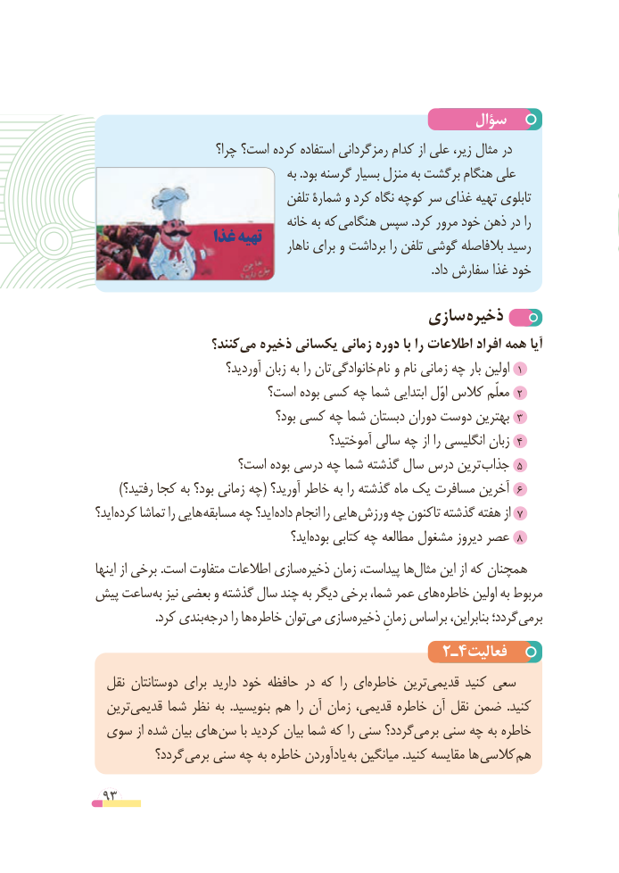

# PDF page 93

سؤال
                       چرا؟ است؟ کرده استفاده رمزگردانی کدام از علی زیر، مثال در
                                       به .بود گرسنه بسیار منزل به برگشت هنگام علی
                                  تلفن شمارۀ و کرد نگاه کوچه سر غذای تهیه تابلوی
                                     خانه به که هنگامی سپس .کرد مرور خود ذهن در را
                غذا تهیه                                           ناهار برای و برداشت را تلفن گوشی بالفاصله رسید
                                                                                                               .داد سفارش غذا خود

                                    سازی ذخیره
                    کنند؟‌می ذخیره یکسانی زمانی دوره با را اطالعات افراد همه آیا
                          آوردید؟ زبان به را تان خانوادگی نام١و نام زمانی چه بار اولین
   است؟٢بوده کسی چه شما ابتدایی اوّل کالس معلّم
    بود؟٣کسی چه شما دبستان دوران دوست بهترین
           آموختید؟٤سالی چه از را انگلیسی زبان
                    است؟ بوده درسی چه شما گذشته سال درس ترین جذاب٥
      )رفتید؟٦کجا به بود؟ زمانی چه( آورید؟ خاطر به را گذشته ماه یک مسافرت آخرین
اید؟ کرده تماشا را هایی مسابقه چه اید؟ داده انجام را هایی ورزش چه تاکنون گذشته هفته از ٧
                                          اید؟بوده‌    کتابی چه مطالعه مشغول دیروز عصر 8
اینها از برخی .است متفاوت اطالعات سازیذخیره‌     زمان پیداست، هامثال‌    این از که همچنان
پیش ساعت به نیز بعضی و گذشته سال چند به دیگر برخی شما، عمر های خاطره اولین به مربوط
  .‌کرد بندیدرجه را ها خاطره توانمی‌  سازیذخیره‌      زمانِ اساس بر بنابراین، گردد؛ برمی
                                      2ـ4فعالیت
  نقل دوستانتان برای دارید خود حافظه در که  را ایخاطره‌     ترینقدیمی‌      کنید سعی
  ترینقدیمی‌     شما نظر به  .بنویسید هم را آن زمان قدیمی، خاطره آن نقل ضمن  .کنید
 سوی از شده بیان های سن با کردید بیان شما که را سنی گردد؟می‌    بر سنی چه به خاطره
          گردد؟ برمی سنی چه به خاطره یادآوردن به میانگین .کنید مقایسه ها کالسی هم

 93

