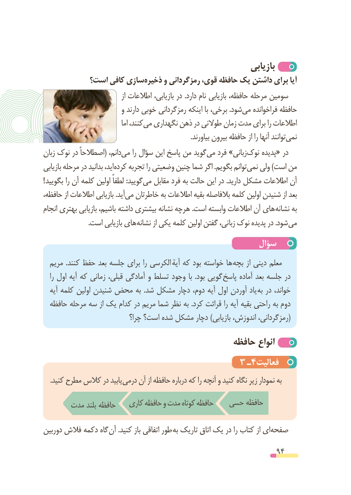

# PDF page 94

بازیابی
          است؟ کافی سازیذخیره‌     و رمزگردانی قوی، حافظه یک داشتن برای آیا
                                      از اطالعات ،سومین‌بازیابی در .دارد نام بازیابی حافظه، مرحله
                         و دارند خوبی رمزگردانی اینکه با برخی، .شودمی‌   فراخوانده حافظه
                                    اما کنند،می‌  نگهداری ذهن در طوالنی زمان مدت برای را اطالعات
   .‌بیاورند بیرون حافظه از را آنها توانندنمی
زبان نوک در اصطالحاً( دانم،می‌    را سؤال این پاسخ من گویدمی‌   فرد »زبانینوک‌    پدیده« در
بازیابی مرحله در بدانید اید، کرده تجربه را وضعیتی چنین شما اگر .بگویم توانمنمی‌   ولی )است من
! بگویید را آن کلمه اولین لطفاً :گوییدمی‌   مقابل فرد به حالت این در .دارید مشکل اطالعات آن
حافظه، از اطالعات بازیابی .آیدمی‌  خاطرتان به اطالعات بقیه بالفاصله کلمه اولین شنیدن از بعد
انجام بهتری بازیابی باشیم، داشته بیشتری نشانه هرچه .است وابسته اطالعات آن های نشانه به
  . است بازیابی های نشانه از یکی کلمه اولین گفتن زبانی، نوک پدیده در .شود می
                                                سؤال
  مریم  .کنند حفظ بعد جلسه برای را الکرسی آیه که بود خواسته ها بچه از دینی معلم
   را اول آیه که زمانی قبلی، آمادگی و تسلط وجود با  .بود گویی پاسخ آماده بعد جلسه در
  آیه کلمه اولین شنیدن محض به  .شد مشکل دچار دوم، آیه اول آوردن یاد به در خواند،
  حافظه مرحله سه از یک کدام در مریم شما نظر به .کرد قرائت را آیه بقیه راحتی به دوم
                            چرا؟ است؟ شده مشکل دچار )بازیابی اندوزش، رمزگردانی،(
                                          حافظه انواع
                                      3 ـ٤فعالیت
. کنید مطرح کالس در یابید درمی آن از حافظه درباره که را آنچه و کنید نگاه زیر نمودار به
                        کاری حافظه و مدت  کوتاه حافظه   حسی حافظه      مدت بلند حافظه
دوربین فالش دکمه گاه آن .کنید باز اتفاقی طور به تاریک اتاق یک در را کتاب از ایصفحه‌

                                                          94

