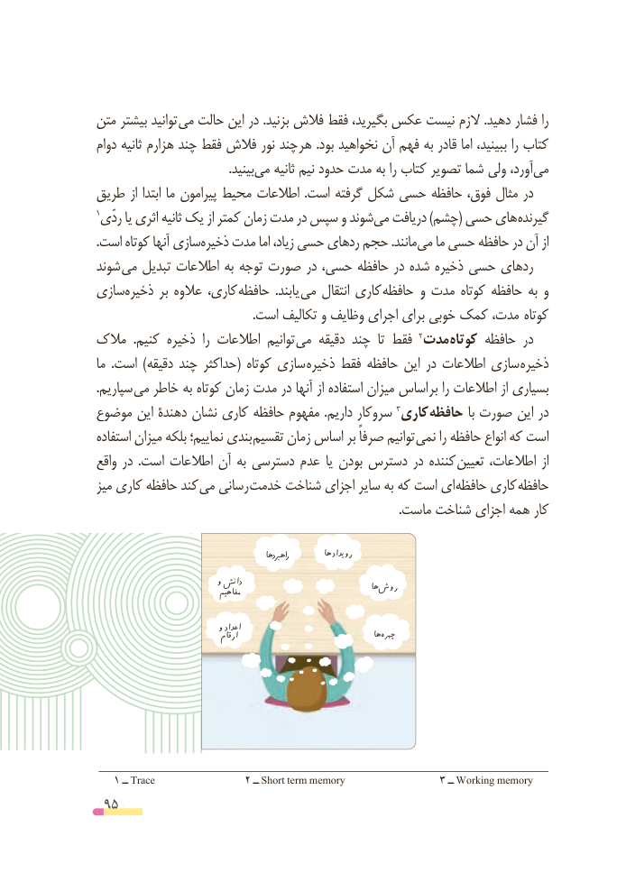

# PDF page 95

متن بیشتر توانید می حالت این در .بزنید فالش فقط بگیرید، عکس نیست الزم .دهید فشار را
دوام ثانیه هزارم چند فقط فالش نور چند هر .بود نخواهید آن فهم به قادر اما ببینید، را کتاب
         .‌بینیدمی ثانیه نیم حدود مدت به را کتاب تصویر شما ولی آورد،می‌
طریق از ابتدا ما پیرامون محیط اطالعات  .است گرفته شکل حسی حافظه فوق، مثال در
1ردّی یا اثری ثانیه یک از کمتر زمان مدت در سپس و شوندمی‌  دریافت )چشم( حسی های گیرنده
.‌است کوتاه آنها سازیذخیره مدت اما زیاد، حسی ردهای حجم .مانندمی‌   ما حسی حافظه در آن از
شوند می تبدیل اطالعات به توجه صورت در حسی، حافظه در شده ذخیره حسی ردهای
سازیذخیره‌       بر عالوه کاری، حافظه  .یابند می انتقال کاری حافظه  و مدت کوتاه حافظه به و
                                                   .است تکالیف و وظایف اجرای برای خوبی کمک مدت،  کوتاه
مالک  .کنیم ذخیره  را اطالعات توانیم می دقیقه چند  تا فقط                                                                                     2مدت کوتاه حافظه در
ما  .است )دقیقه چند حداکثر( کوتاه سازی ذخیره فقط حافظه این در اطالعات سازی ذخیره
.سپاریم می خاطر به کوتاه زمان مدت در آنها از استفاده میزان اساس بر را اطالعات از بسیاری
موضوع این دهندۀ نشان کاری حافظه مفهوم .داریم سروکار                                                                               3کاری حافظه با صورت این در
استفاده میزان بلکه نماییم؛ بندی تقسیم زمان اساس بر صرفاً توانیم نمی را حافظه انواع که است
واقع در  .است اطالعات آن به دسترسی عدم یا بودن دسترس در کننده تعیین اطالعات، از
میز کاری حافظه کند می رسانی خدمت شناخت اجزای سایر به که است ای حافظه کاری حافظه
                                                                                                   .ماست شناخت اجزای همه کار

                                                          راهربدها          رویدادها
                            و دانش                                                                        ها روش                                   مفاهیم

                            و اعداد                                   ارقام                                    ها چهره

   1 ــ Trace                2 ــ Short term memory                 3 ــ Working memory
 95

