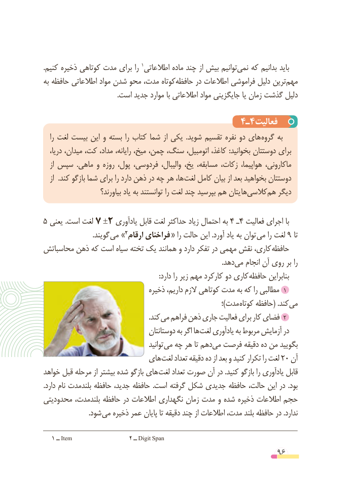

# PDF page 96

.کنیم١توانیمذخیره کوتاهی مدت برای را  اطالعاتی ماده چند از بیش     نمی‌   که بدانیم باید
به حافظه اطالعاتی مواد شدن محو مدت، کوتاهحافظه‌      در اطالعات فراموشی دلیل ترینمهم‌
                                           .است جدید موارد با اطالعاتی مواد جایگزینی یا زمان گذشت دلیل

                                      4ـ٤فعالیت
   را لغت بیست این و بسته را کتاب شما از یکی  .شوید تقسیم نفره دو های گروه به
   دریا، میدان، کت، مداد، رایانه، میخ، چمن، سنگ، اتومبیل، کاغذ، :بخوانید دوستتان برای
   از سپس  .ماهی و روزه پول، فردوسی، والیبال، یخ، مسابقه، زکات، هواپیما، ماکارونی،
   از  .کند بازگو شما برای را دارد ذهن در چه هر ها، لغت کامل بیان از بعد بخواهید دوستتان
                      بیاورند؟ یاد به توانستند را لغت چند بپرسید هم یتان هاکالسی‌    هم‌   دیگر

5 یعنی .است لغت 7 ±2 یادآوری قابل لغت حداکثر زیاد احتمال به 4 ـ4 فعالیت اجرای با
     . »گویند می٢فراخنایارقام            « را حالت این .آورد یاد به توان می را لغت 9 تا
محاسباتش ذهن که است سیاه تخته یک همانند و دارد تفکر در مهمی نقش کاری، حافظه
                                                                                                       .دهدمی‌   انجام آن روی بر را
   : دارد را زیر مهم کارکرد دو کاری حافظه بنابراین
                                 ذخیره داریم، الزم کوتاهی مدت به که را مطالبی ١
                                                                                            ؛)مدت کوتاه حافظه( .کندمی‌
               . کند می فراهم ذهن جاری فعالیت برای کار فضای 2
                                    دوستانتان به اگر ها لغت یادآوری به مربوط آزمایش در
                                           توانید می چه هر تا دهممی‌  فرصت دقیقه ده من بگویید
                         های لغت تعداد دقیقه ده از بعد و کنید تکرار را لغت 20 آن
خواهد قبل مرحله از بیشتر شده بازگو های لغت تعداد صورت آن در .کنید بازگو را یادآوری قابل
.دارد نام بلندمدت حافظه جدید، حافظه .است گرفته شکل جدیدی حافظه حالت، این در .بود
محدودیتی بلندمدت، حافظه در اطالعات نگهداری زمان مدت و شده ذخیره اطالعات حجم
      . شود می ذخیره عمر پایان تا دقیقه چند از اطالعات مدت، بلند حافظه در .ندارد

   1 ــ Item                  ٢ ــ Digit Span
                                                          96

