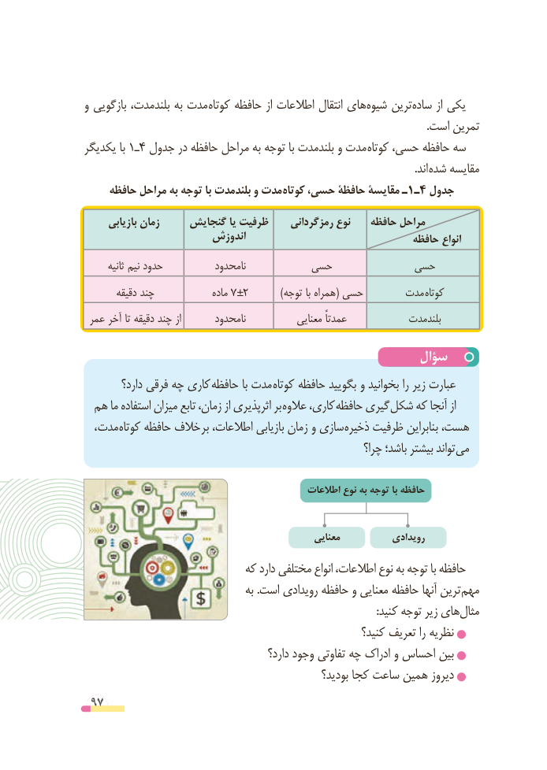

# PDF page 97

و بازگویی بلندمدت، به مدت کوتاه حافظه از اطالعات انتقال هایشیوه‌    ترینساده‌      از یکی
                                                                                                                                .است تمرین
یکدیگر با 1ـ4 جدول در حافظه مراحل به توجه با بلندمدت و مدت کوتاه حسی، حافظه سه
                                       . اند شده مقایسه
     حافظه مراحل به توجه با بلندمدت و مدت کوتاه حسی، حافظۀ مقایسۀ ـ1ـ4 جدول

      بازیابی زمان     گنجایش یا ظرفیت     رمزگردانی نوع    حافظه مراحل
                       اندوزش                                حافظه انواع
       ثانیه نیم حدود            نامحدود         حسی            حسی
        دقیقه چند               ماده 7 ±2          )توجه با همراه( حسی       مدت کوتاه
 عمر آخر تا دقیقه چند از        نامحدود            معنایی عمدتاً             بلندمدت

                                                سؤال
         دارد؟ فرقی چه کاری حافظه با مدت کوتاه حافظه بگویید و بخوانید را زیر عبارت
 هم ما استفاده میزان تابع زمان، از اثرپذیری بر عالوه کاری، حافظه گیری شکل که آنجا از
   ، مدت کوتاه حافظه خالف بر اطالعات، بازیابی زمان و سازی ذخیره ظرفیت بنابراین هست،
                                                            چرا؟ باشد؛ بیشتر تواند می

                                               اطالعات نوع به توجه با حافظه

                                                     معنایی           رویدادی
                            که دارد مختلفی انواع اطالعات، نوع به توجه با حافظه
                                     به .است رویدادی حافظه و معنایی حافظه آنها ترین مهم
       :‌کنید توجه زیر هایمثال
                                                          کنید؟ تعریف را نظریه
                                           دارد؟ وجود تفاوتی چه ادراک و احساس بین
                                                     بودید؟ کجا ساعت همین دیروز
 97

