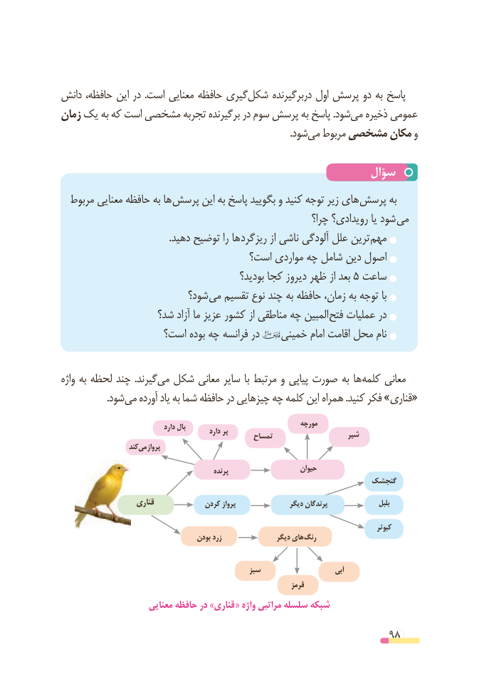

# PDF page 98

دانش حافظه، این در  .است معنایی حافظه گیریشکل‌     دربرگیرنده اول پرسش دو به پاسخ
زمان یک به که است مشخصی تجربه برگیرنده در سوم پرسش به پاسخ .شودمی‌   ذخیره عمومی
                                                                                               .شودمی‌  مربوط مشخصی مکان و

                                                 سؤال
  مربوط معنایی حافظه به ها پرسش این به پاسخ بگویید و کنید توجه زیر های پرسش به
                                                           چرا؟ رویدادی؟ یا شود می
   . دهید توضیح را ها ریزگرد از ناشی آلودگی علل ترین مهم
                                 است؟ مواردی چه شامل دین اصول
                                            بودید؟ کجا دیروز ظهر از بعد 5 ساعت
                         شود؟ می تقسیم نوع چند به حافظه زمان، به توجه با
                  شد؟ آزاد ما عزیز کشور از مناطقی چه المبین فتح عملیات در
                  است؟ بوده چه فرانسه در       خمینی امام اقامت محل نام

واژه به لحظه چند  .گیرندمی‌  شکل معانی سایر با مرتبط و پیاپی صورت به ها کلمه معانی
    .‌شودمی آورده یاد به شما حافظه در چیزهایی چه کلمه این همراه .کنید فکر »قناری«

                                                                    مورچه                                     دارد بال                                                     دارد پر                                                 تمساح                    شیر
                     کند می پرواز
                                                   پرنده                     حیوان
                                                               گنجشک
                     قناری             کردن پرواز                دیگر پرندگان                   بلبل

                                                                                                         کبوتر
                                       بودن زرد                دیگر های رنگ

                                                 سبز                        آبی
                                                                      قرمز
                      معنایی حافظه در »قناری « واژه مراتبی سلسله شبکه

                                                          98

