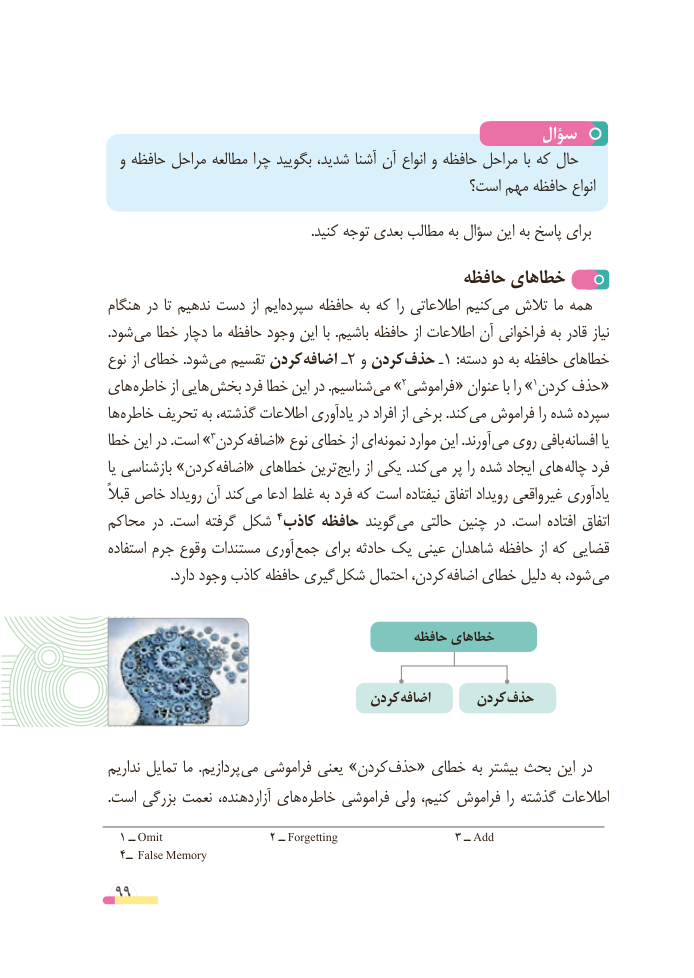

# PDF page 99

سؤال
  و حافظه مراحل مطالعه چرا بگویید شدید، آشنا آن انواع و حافظه مراحل با که حال
                                              است؟ مهم حافظه انواع
                                                            .کنید توجه بعدی مطالب به سؤال این به پاسخ برای
                                          حافظه خطاهای
هنگام در تا ندهیم دست از ایمسپرده‌     حافظه به که را اطالعاتی کنیممی‌  تالش ما همه
.شود می خطا دچار ما حافظه وجود این با .باشیم حافظه از اطالعات آن فراخوانی به قادر نیاز
نوع از خطای .شود می تقسیم کردن اضافه ـ2 و کردن حذف ـ1 :دسته دو به حافظه خطاهای
های خاطره از هایی بخش فرد خطا این در .شناسیم »می  2فراموشی « عنوان با را » 1کردن حذف «
ها خاطره تحریف به گذشته، اطالعات یادآوری در افراد از برخی .کند می فراموش را شده سپرده
خطا این در .است » 3کردن اضافه« نوع خطای از ای نمونه موارد این .آورند می روی بافی افسانه یا
یا بازشناسی »کردن اضافه« خطاهای ترین رایج از یکی .کند می پر را شده ایجاد های چاله فرد
قبالً خاص رویداد آن کند می ادعا غلط به فرد که است نیفتاده اتفاق رویداد واقعی غیر یادآوری
محاکم در  .است گرفته شکل                              4کاذب حافظه گویند می حالتی چنین در  .است افتاده اتفاق
استفاده جرم وقوع مستندات آوری جمع برای حادثه یک عینی شاهدان حافظه از که قضایی
 . دارد وجود کاذب حافظه گیری شکل احتمال کردن، اضافه خطای دلیل به شود، می

                                             حافظه خطاهای

                                    کردن اضافه      کردن حذف

نداریم تمایل ما  .پردازیم می فراموشی یعنی »کردن حذف« خطای به بیشتر بحث این در
.است بزرگی نعمت آزاردهنده، های خاطره فراموشی ولی کنیم، فراموش را گذشته اطالعات

  1 ــ Omit                 2 ــ Forgetting                   3 ــ Add
  4ــ False Memory
 99

