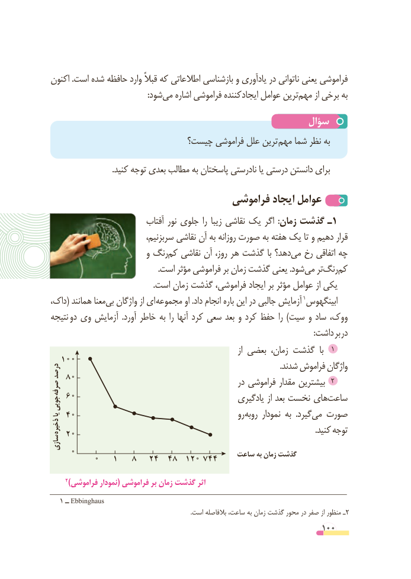

# PDF page 100

اکنون .است شده حافظه وارد قبالً که اطالعاتی بازشناسی و یادآوری در ناتوانی یعنی فراموشی
           :‌شودمی اشاره فراموشی کننده ایجاد عوامل ترینمهم‌     از برخی به
                                                 سؤال
                           چیست؟ فراموشی علل ترین مهم شما نظر به
                               .کنید توجه بعدی مطالب به پاسختان نادرستی یا درستی دانستن برای

                                  فراموشی ایجاد عوامل
                           آفتاب نور جلوی را زیبا نقاشی یک اگر  :زمان گذشت ـ1
  ،قرارسربزنیم نقاشی آن به روزانه صورت به هفته یک تا و دهیم
                          و رنگکم‌  نقاشی آن روز، هر گذشت با دهد؟می‌  رخ اتفاقی چه
 .‌است مؤثر فراموشی بر زمان گذشت یعنی .شودمی تررنگ‌  کم‌
                                                   .است زمان گذشت فراموشی، ایجاد بر مؤثر عوامل از یکی
داک،( همانند معنا ‌بی واژگان از ای  مجموعه او .داد انجام باره این در جالبی آزمایش 1ابینگهوس
نتیجه دو وی آزمایش  .آورد خاطر به را آنها کرد سعی بعد و کرد حفظ را )سیت و ساد ووک،
                       : داشت بر در
                                                                               از بعضی زمان، گذشت  با  1
  100                                                                                                     .شدند فراموش واژگاندرصد
   80                                               در فراموشی مقدار بیشترین  2صرفه    60                                                  یادگیری از بعد نخست هایساعت‌جویی
یا 40                                                       رو روبه نمودار به  .گیردمی‌  صورت
ذخیره    20                                                                                                                       .کنید توجه
سازی
    0                                     ساعت به زمان گذشت         0   1   8   24  48  120 744

      2)فراموشی نمودار( فراموشی بر زمان گذشت اثر
   1 ــ Ebbinghaus
                                                                                               .است بالفاصله ساعت، به زمان گذشت محور در صفر از منظور ـ2
                                                          100

