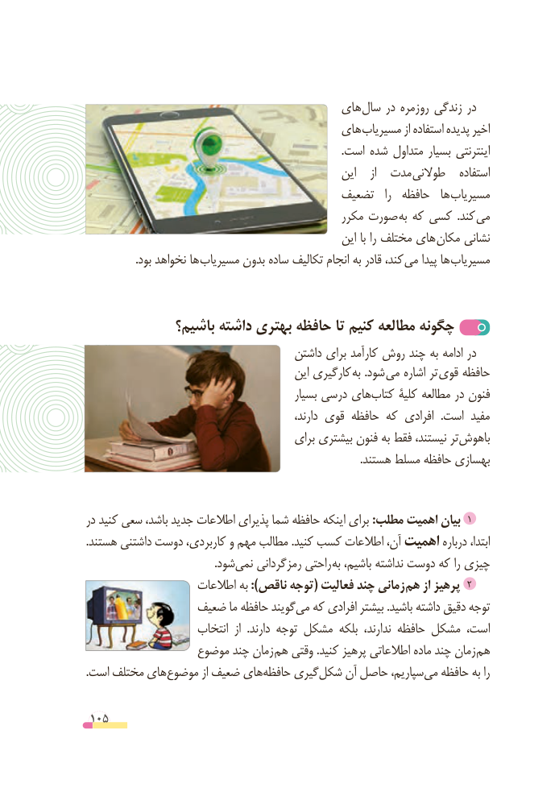

# PDF page 105

های سال در روزمره زندگی در
                                      های مسیریاب از استفاده پدیده اخیر
                                                                                             .است شده متداول بسیار اینترنتی
                                                    این    از  مدت طوالنی   استفاده
                                       تضعیف   را  حافظه  ها مسیریاب
                                              مکرر صورت به که کسی  .کند می
                                                    این با را مختلف های مکان نشانی
 . بود نخواهد ها مسیریاب بدون ساده تکالیف انجام به قادر کند، می پیدا ها مسیریاب

             باشیم؟ داشته بهتری حافظه تا کنیم مطالعه چگونه
                                      داشتن برای کارآمد روش چند به ادامه در
                                          این کارگیری به .شود می اشاره تر قوی حافظه
                                              بسیار درسی هایکتاب‌     کلیۀ مطالعه در فنون
                                                     دارند، قوی حافظه که افرادی  .است مفید
                                        برای بیشتری فنون به فقط نیستند، ترباهوش‌
                                                                                                    .هستند مسلط حافظه بهسازی

در کنید سعی باشد، جدید اطالعات پذیرای شما حافظه اینکه برای :مطلب اهمیت بیان 1
.هستند داشتنی دوست‌      کاربردی، و مهم مطالب .کنید کسب اطالعات آن، اهمیت درباره ابتدا،
                                               .شودنمی‌    رمزگردانی راحتی به باشیم، نداشته دوست که را چیزی
                    اطالعات به ):ناقص توجه( فعالیت چند زمانی هم از پرهیز 2
               ضعیف ما حافظه گویندمی‌  که افرادی بیشتر .باشید داشته دقیق توجه
                      انتخاب  از  .دارند توجه مشکل بلکه  ندارند، حافظه مشکل است،
                 موضوع چند زمان هم وقتی .کنید پرهیز اطالعاتی ماده چند زمان هم
.است مختلف هایموضوع‌         از ضعیف هایحافظه‌    گیریشکل‌    آن حاصل سپاریم،می‌  حافظه به را

 105

