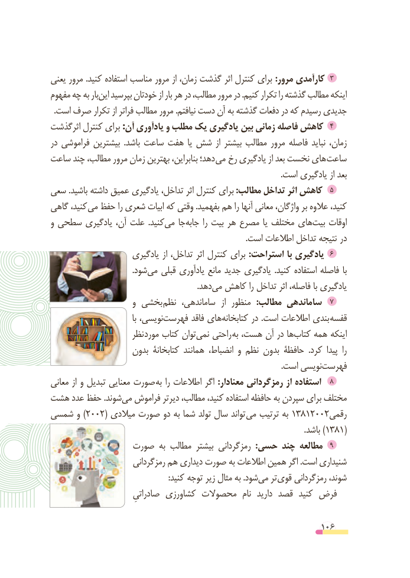

# PDF page 106

یعنی مرور .کنید استفاده مناسب مرور از زمان، گذشت اثر کنترل برای :مرور کارآمدی  3
مفهوم چه به باراین‌   بپرسید خودتان از بار هر در مطالب، مرور در .کنیم تکرار را گذشته مطالب اینکه
  .است صرف تکرار از فراتر مطالب مرور .نیافتم دست آن به گذشته دفعات در که رسیدم جدیدی
                                                                               4اثرگذشت کنترل برای :آن یادآوری و مطلب یک یادگیری بین زمانی فاصله کاهش
در فراموشی بیشترین  .باشد ساعت هفت یا شش از بیشتر مطالب مرور فاصله نباید زمان،
ساعت چند مطالب، مرور زمان بهترین بنابراین، دهد؛ می  رخ یادگیری از بعد نخست های ساعت
                                                                                                                  .است یادگیری از بعد
سعی .باشید داشته عمیق یادگیری تداخل، اثر کنترل برای :مطالب تداخل اثر کاهش  5
گاهی کنید، می حفظ را شعری ابیات که وقتی .بفهمید هم را آنها معانی واژگان، بر عالوه کنید،
و سطحی یادگیری آن، علت  .کنیدمی‌   جاجابه‌      را بیت هر مصرع یا مختلف هایبیت‌    اوقات
                                                                                                 .است اطالعات تداخل نتیجه  در
                     یادگیری از تداخل، اثر کنترل برای :استراحت با یادگیری  6
                                         .شودمی‌   قبلی یادآوری مانع جدید یادگیری  .کنید استفاده فاصله  با
                                                                         .دهدمی‌  کاهش را تداخل اثر فاصله، با یادگیری
                      و بخشی 7نظم ساماندهی،  از منظور  :مطالب ساماندهی
                                     با نویسی،فهرست‌        فاقد هایکتابخانه‌        در .است اطالعات بندی قفسه
                     نظر مورد کتاب تواننمی‌   راحتی به هست، آن در هاکتاب‌    همه اینکه
                    بدون کتابخانة همانند انضباط، و نظم بدون حافظة  .کرد  پیدا  را
           .‌است نویسیفهرست
معانی از و تبدیل معنایی صورت به را اطالعات اگر :معنادار رمزگردانی از استفاده   8
هشت عدد حفظ .شوندمی‌  فراموش دیرتر مطالب، کنید، استفاده حافظه به سپردن برای مختلف
شمسی و )2002( میالدی صورت دو به شما تولد سال تواند می ترتیب به 13812002رقمی
                                                                                                                              .باشد )1381(
               صورت به مطالب بیشتر رمزگردانی  :حسی چند مطالعه  9
                       رمزگردانی هم دیداری صورت به اطالعات همین اگر .است شنیداری
             : کنید توجه زیر مثال به .شودمی‌   تر قوی رمزگردانی شوند،
                        صادراتیِ کشاورزی محصوالت  نام  دارید قصد  کنید فرض

                                                          106

