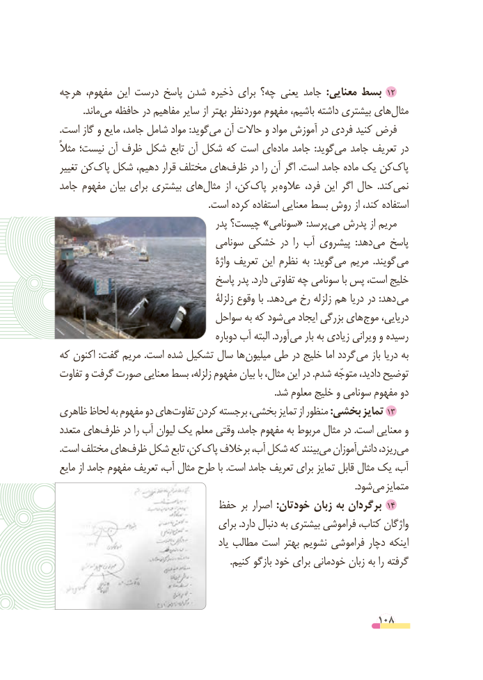

# PDF page 108

چه هر مفهوم، این درست پاسخ شدن ذخیره برای چه؟ یعنی جامد  :معنایی بسط 12
          .ماندمی‌  حافظه در مفاهیم سایر از بهتر نظر مورد مفهوم باشیم، داشته بیشتری هایمثال‌
.است گاز و مایع جامد، شامل مواد :گویدمی‌  آن حاالت و مواد آموزش در فردی کنید فرض
مثالً نیست؛ آن ظرف شکل تابع آن شکل که است ایماده‌    جامد  :گویدمی‌   جامد تعریف در
تغییر کنپاک‌  شکل دهیم، قرار مختلف هایظرف‌     در را آن اگر .است جامد ماده یک کنپاک‌
جامد مفهوم بیان برای بیشتری هایمثال‌      از کن،پاک‌     بر عالوه فرد، این اگر حال  .کندنمی‌
                                                               .است کرده استفاده معنایی بسط روش از کند، استفاده
                                       پدر چیست؟ »سونامی« :پرسد می پدرش از مریم
                                 سونامی خشکی در  را آب پیشروی  :دهد می پاسخ
                                            واژۀ تعریف این نظرم به  :گوید می مریم  .گویند می
                                 پاسخ پدر .دارد تفاوتی چه سونامی با پس است، خلیج
                                            زلزلة وقوع با .دهد می رخ زلزله هم دریا در :دهد می
                             سواحل به که شود می ایجاد بزرگی های موج دریایی،
                                            دوباره آب البته .آورد می بار به زیادی ویرانی و رسیده
که اکنون :گفت مریم .است شده تشکیل سال ها میلیون طی در خلیج اما گردد می باز دریا به
تفاوت و گرفت صورت معنایی بسط زلزله، مفهوم بیان با مثال، این در .شدم متوجّه دادید، توضیح
                                                                                           .شد معلوم خلیج و سونامی مفهوم دو
ظاهری لحاظ به مفهوم دو های تفاوت کردن برجسته بخشی، تمایز از منظور :بخشی تمایز 13
متعدد هایظرف‌     در را آب لیوان یک معلم وقتی جامد، مفهوم به مربوط مثال در .است معنایی و
.است مختلف هایظرف‌   شکل تابع کن، پاک خالف بر آب، شکل که بینندمی‌   آموزاندانش‌     ریزد،می‌
مایع از جامد مفهوم تعریف آب، مثال طرح با .است جامد تعریف برای تمایز قابل مثال یک آب،
                                                                                                                             .شود می متمایز
                          حفظ بر اصرار :خودتان زبان به برگردان 14
                                    برای .دارد دنبال به بیشتری فراموشی کتاب، واژگان
                                               یاد مطالب است بهتر نشویم فراموشی دچار اینکه
                                                                        .کنیم بازگو خود برای خودمانی زبان به را گرفته

                                                          108

