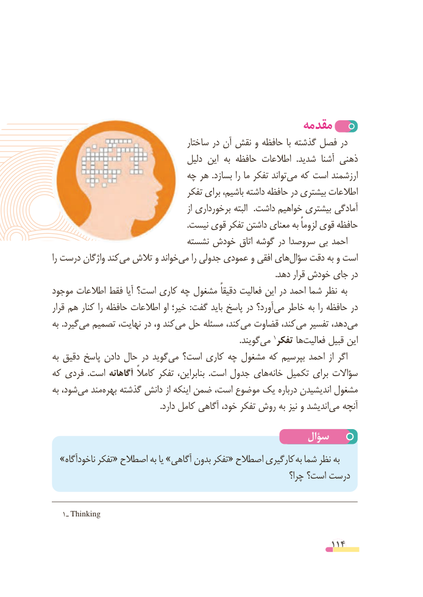

# PDF page 114

مقدمه
                                     ساختار در آن نقش و حافظه با گذشته فصل در
                                   دلیل این  به حافظه اطالعات  .شدید  آشنا ذهنی
                            چه هر  .بسازد را ما تفکر تواندمی‌  که است ارزشمند
                                   تفکر برای باشیم، داشته حافظه در بیشتری اطالعات
                                                    از برخورداری البته   .داشت خواهیم بیشتری آمادگی
                                                                 .نیست قوی تفکر داشتن معنای به لزوماً قوی حافظه
                              نشسته خودش اتاق گوشه در سروصدا بی احمد
را درست واژگان کندمی‌  تالش و خواندمی‌    را جدولی عمودی و افقی هایسؤال‌   دقت به و است
                                                                                                            .دهد قرار خودش جای در
موجود اطالعات فقط آیا است؟ کاری چه مشغول دقیقاً فعالیت این در احمد شما نظر  به
قرار هم کنار را حافظه اطالعات او خیر؛  :گفت باید پاسخ در آورد؟می‌   خاطر به را حافظه در
به .گیردمی‌  تصمیم نهایت، در و، کند‌می حل مسئله کند، می‌  قضاوت کند،می‌   تفسیر دهد،می‌
                .‌گویندمی 1تفکر ها‌فعالیت قبیل این
به دقیق پاسخ دادن حال در گوید ‌می است؟ کاری چه مشغول که بپرسیم احمد از اگر
که فردی  .است آگاهانه کامالً تفکر بنابراین،  .است جدول هایخانه‌   تکمیل برای سؤاالت
به شود،می‌   مند‌بهره گذشته دانش از اینکه ضمن است، موضوع یک درباره اندیشیدن مشغول
 .‌دارد کامل آگاهی خود، تفکر روش به نیز و اندیشدمی آنچه

                                               سؤال
  »ناخودآگاه تفکر« اصطالح به یا »آگاهی بدون تفکر« اصطالح کارگیری  به شما نظر به
                                                                 چرا؟ است؟ درست

   1ـ Thinking

                                                          114

