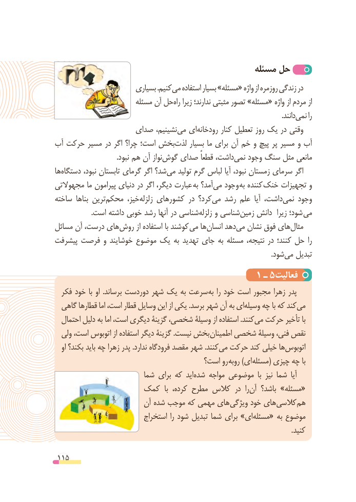

# PDF page 115

مسئله حل
                       بسیاری .کنیممی‌   استفاده بسیار »مسئله« واژه از روزمره زندگی در
                        مسئله آن حلراه‌   زیرا ندارند؛ مثبتی تصور »مسئله« واژه از مردم از
                            .‌دانندنمی را
                  صدای نشینیم،می‌  ای‌رودخانه کنار تعطیل روز یک در وقتی
آب حرکت مسیر در اگر چرا؟ است؛ بخش‌لذت بسیار ما برای آن خم و پیچ پر مسیر و آب
   .‌نبود هم آن نوازگوش صدای قطعاً داشت،‌نمی وجود سنگ مثل مانعی
ها‌دستگاه نبود، تابستان گرمای اگر شد؟ ‌می تولید گرم لباس آیا نبود، زمستان سرمای اگر
مجهوالتی ما پیرامون دنیای در اگر دیگر، عبارت  به آمد؟‌می وجود به کننده خنک تجهیزات و
ساخته ها‌بنا ترین ‌محکم خیز،زلزله‌    کشورهای در کرد؟می‌   رشد علم  آیا داشت،نمی‌    وجود
                     .است داشته خوبی رشد آنها در شناسی ‌زلزله و شناسیزمین‌    دانش  زیرا شود؛ می
مسائل آن درست، های‌روش از استفاده با کوشند  می ها‌انسان دهدمی‌  نشان فوق های‌مثال
پیشرفت فرصت و خوشایند موضوع یک به تهدید جای به مسئله نتیجه، در کنند؛ حل را
                            .‌شودمی تبدیل
                                      1 ـ 5فعالیت
  فکر خود با او  .برساند دوردست شهر یک به سرعت به را خود است مجبور زهرا پدر
  گاهی قطارها اما است، قطار وسایل این از یکی .برسد شهر آن به ایوسیله‌    چه با که کندمی‌
  احتمال دلیل به اما است، دیگری گزینة شخصی، وسیلة از استفاده .کنندمی‌  حرکت تأخیر با
  ولی است، اتوبوس از استفاده دیگر گزینة .نیست بخش اطمینان شخصی وسیلة فنی، نقص
   او بکند؟ باید چه زهرا پدر .ندارد فرودگاه مقصد شهر .کنندمی‌  حرکت کند خیلی هااتوبوس‌
                                     است؟ رو روبه )ای مسئله( چیزی چه با
                         شما برای که اید شده مواجه موضوعی  با نیز شما  آیا
                کمک  با کرده، مطرح کالس در  را «آن باشد؟ »مسئله
                        آن شده موجب که مهمی های ویژگی خود های کالسی هم
                           استخراج را شود تبدیل شما برای »ای مسئله« به موضوع
                                                                                                                           . کنید

 115

