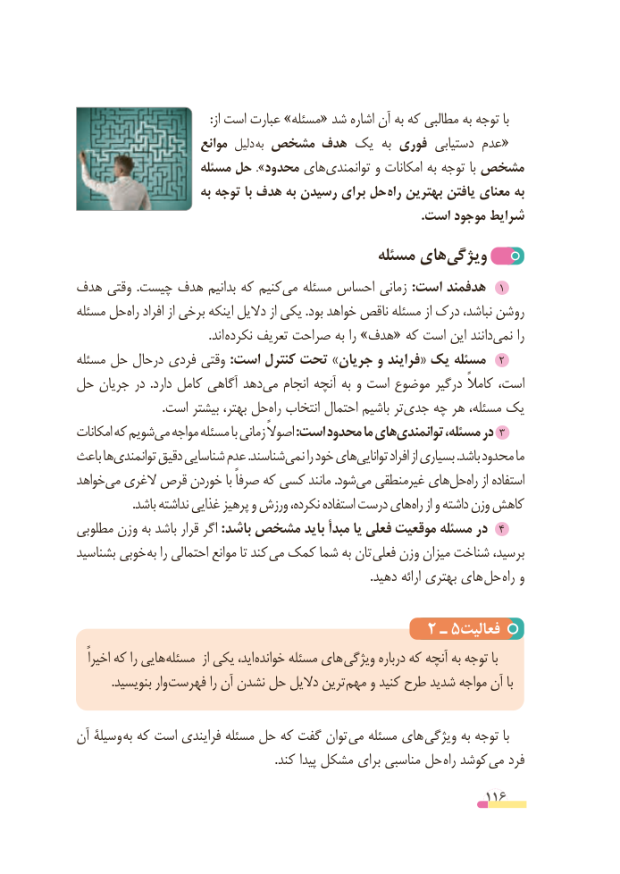

# PDF page 116

:از است عبارت »مسئله« شد اشاره آن به که مطالبی به توجه با
                       موانع دلیل «به مشخص هدف یک  به فوری دستیابی عدم
                    مسئله حل ».محدود های‌توانمندی و امکانات به توجه با مشخص
                        به توجه با هدف به رسیدن برای حل راه بهترین یافتن معنای به
                                                                                                    .است موجود شرایط
                                        مسئله های‌ویژگی
هدف وقتی  .چیست هدف بدانیم که کنیم‌می مسئله احساس زمانی :است هدفمند   1
مسئله حلراه‌   افراد از برخی اینکه دالیل از یکی .بود خواهد ناقص مسئله از درک نباشد، روشن
                                           .اند نکرده تعریف صراحت به را »هدف« که است این دانند‌نمی را
مسئله حل درحال فردی وقتی :است کنترل تحت »جریان و فرایند« یک مسئله  ٢
حل جریان در  .دارد کامل آگاهی دهدمی‌   انجام آنچه به و است موضوع درگیر کامالً است،
                            .است بیشتر بهتر، حلراه‌  انتخاب احتمال باشیم تر‌جدی چه هر مسئله، یک
امکانات که شویممی‌  مواجه مسئله با زمانی اصوالً :است محدود ما هایتوانمندی‌        مسئله، در ٣
باعث هاتوانمندی‌      دقیق شناسایی عدم .شناسندنمی‌     را خود هایتوانایی‌       افراد از بسیاری .باشد محدود ما
خواهد می الغری قرص خوردن با صرفاً که کسی مانند .شودمی‌  غیرمنطقی هایحل‌   راه‌   از استفاده
                  .باشد نداشته غذایی پرهیز و ورزش نکرده، استفاده درست های راه از و داشته وزن کاهش
مطلوبی وزن به باشد قرار اگر :باشد مشخص باید مبدأ یا فعلی موقعیت مسئله در  ٤
بشناسید خوبی به را احتمالی موانع تا کند  می کمک شما به تان  فعلی وزن میزان شناخت برسید،
     . دهید ارائه بهتری های حل  راه و

                                      2 ـ 5فعالیت
   اخیراً که را هایی مسئله  از یکی اید، خوانده مسئله های ویژگی درباره که آنچه به توجه با
 . بنویسید وار فهرست را آن نشدن حل دالیل ترین مهم و کنید طرح شدید مواجه آن با

آن وسیلة به که است فرایندی مسئله حل که گفت توان می مسئله های ویژگی به توجه با
  . کند پیدا مشکل برای مناسبی حل راه کوشد می فرد

                                                          116

