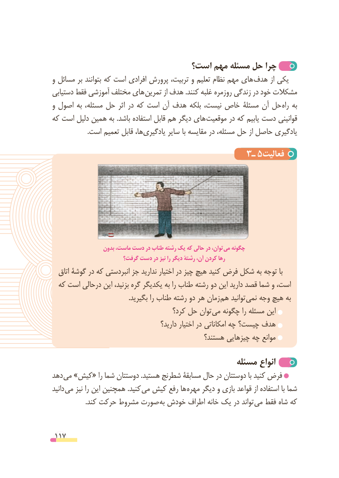

# PDF page 117

است؟ مهم مسئله حل چرا
و مسائل بر بتوانند که است افرادی پرورش تربیت، و تعلیم نظام مهم های هدف از یکی
دستیابی فقط آموزشی مختلف های  تمرین از هدف .کنند غلبه روزمره زندگی در خود مشکالت
و اصول به مسئله، حل اثر در که است آن هدف بلکه نیست، خاص مسئلة آن حل  راه به
که است دلیل همین به .باشد استفاده قابل هم دیگر های موقعیت در که یابیم دست قوانینی
 .‌است تعمیم قابل ها،یادگیری سایر با مقایسه در مسئله، حل از حاصل یادگیری
                                      3ـ 5فعالیت

                  بدون ماست، دست در طناب رشته یک که حالی در توان، می چگونه
                       گرفت؟ دست در نیز را دیگر رشتة آن، کردن رها
  اتاق گوشة در که انبردستی جز ندارید اختیار در چیز هیچ کنید فرض شکل به توجه با
  که است درحالی این بزنید، گره یکدیگر به را طناب رشته دو این دارید قصد شما و است،
  . بگیرید را طناب رشته دو هر زمان هم توانید نمی وجه هیچ به
                                     کرد؟ حل توان می چگونه را مسئله این
                                         دارید؟ اختیار در امکاناتی چه چیست؟ هدف
                                             هستند؟ چیزهایی چه موانع

                                             مسئله انواع
دهد می »کیش« را شما دوستتان .هستید شطرنج مسابقة حال در دوستتان با کنید فرض
دانید می نیز را این همچنین .کنید می کیش رفع ها  مهره دیگر و بازی قواعد از استفاده با شما
 . کند حرکت مشروط صورت به خودش اطراف خانه یک در تواند می فقط شاه که

 117

