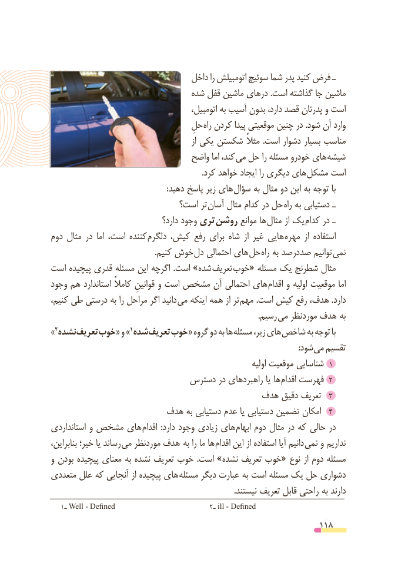

# PDF page 118

داخل را اتومبیلش سوئیچ شما پدر کنید فرض ـ
                                شده قفل ماشین درهای .است گذاشته جا ماشین
                                            اتومبیل، به آسیب بدون دارد، قصد پدرتان و است
                                    حلِ راه کردن پیدا موقعیتی چنین در .شود آن وارد
                                                         از یکی شکستن مثالً  .است دشوار بسیار مناسب
                               واضح اما کند، می حل را مسئله خودرو های شیشه
   . کرد خواهد ایجاد را دیگری های مشکل است
   : دهید پاسخ زیر های سؤال به مثال دو این به توجه با
                           است؟ تر آسان مثال کدام در حل راه به دستیابی ـ
                                   دارد؟ وجود تری روشن موانع ها مثال از یک  کدام در ـ
دوم مثال در  اما است، کننده دلگرم کیش، رفع برای شاه  از غیر هایی  مهره  از استفاده
     . کنیم خوش دل احتمالی های حل  راه به صددرصد توانیم نمی
است پیچیده قدری مسئله این اگرچه .است »شده تعریف خوب« مسئله یک شطرنج مثال
وجود هم استاندارد کامالً قوانینِ و است مشخص آن احتمالی های اقدام و اولیه موقعیت اما
کنیم، طی درستی به را مراحل اگر دانید  می اینکه همه از تر مهم .است کیش رفع هدف، .دارد
                   . رسیم می موردنظر هدف به
» 2نشده تعریف »خوب« و                         1شده تعریف خوب« گروه دو به ها مسئله زیر، های شاخص به توجه با
                            : شود می تقسیم
                                                                      اولیه موقعیت شناسایی  1
                           دسترس در راهبردهای یا ها اقدام فهرست  ٢
                                     هدف دقیق تعریف  ٣
                    هدف به دستیابی عدم یا دستیابی تضمین امکان  ٤
استانداردی و مشخص های اقدام  :دارد وجود زیادی های ابهام دوم مثال در که حالی در
بنابراین، خیر؛ یا رساند می موردنظر هدف  به را ما ها اقدام این از استفاده آیا دانیم نمی و نداریم
و بودن پیچیده معنای به نشده تعریف خوب  .است »نشده تعریف خوب« نوع از دوم مسئله
متعددی علل که آنجایی از پیچیده های  مسئله دیگر عبارت به است مسئله یک حل دشواری
                                                                                           .نیستند تعریف قابل راحتی به دارند
   1ـ Well - Defined                         2ـ ill - Defined
                                                          118

