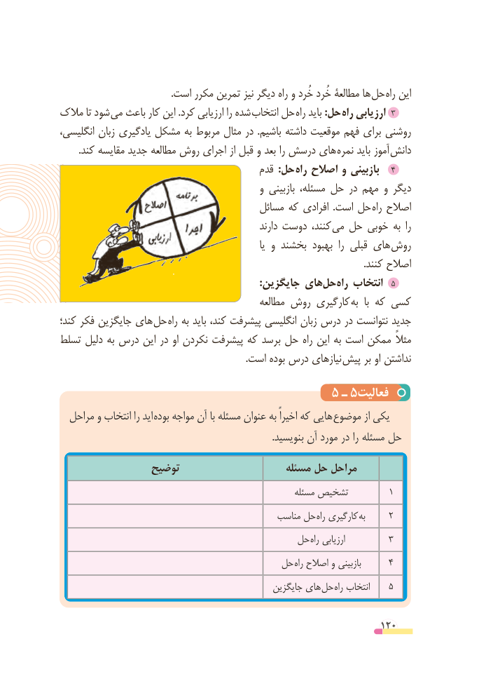

# PDF page 120

.است مکرر تمرین نیز دیگر راه و خُرد خُرد مطالعة ها حل راه این
مالک تا شود می باعث کار این .کرد ارزیابی را شده انتخاب حل راه باید :حل راه ارزیابی ٣
انگلیسی، زبان یادگیری مشکل به مربوط مثال در  .باشیم داشته موقعیت فهم برای روشنی
. کند مقایسه جدید مطالعه روش اجرای از قبل و بعد را درسش های نمره باید آموز دانش
                                          قدم  :حل راه اصالح و بازبینی   ٤
                                             و بازبینی مسئله، حل در مهم و دیگر
                                        مسائل که افرادی  .است حل راه اصالح
                                                       دارند دوست کنند،  می حل خوبی به  را
                                                                    یا و بخشند بهبود  را قبلی های روش
                                                                                                                               .کنند اصالح
                                                                       :جایگزین هایحل‌    ‌راه انتخاب  ٥
                                               مطالعه روش کارگیری به  با که کسی
کند؛ فکر جایگزین های حل راه به باید کند، پیشرفت انگلیسی زبان درس در نتوانست جدید
تسلط دلیل به درس این در او نکردن پیشرفت که برسد حل راه این به است ممکن مثالً
    . است بوده درس نیازهای پیش بر او نداشتن

                                     5 ـ 5فعالیت
  مراحل و انتخاب را اید  بوده مواجه آن با مسئله عنوان به اخیراً که هایی  موضوع از یکی
                                                                                         .بنویسید آن مورد در را مسئله حل

                توضیح                     مسئله حل مراحل
                                                          مسئله تشخیص         1
                                              مناسب حل راه کارگیری  به     2
                                       حل راه ارزیابی         3
                                    حل راه اصالح و بازبینی      4
                                                  جایگزین های حل راه انتخاب    5

                                                          120

