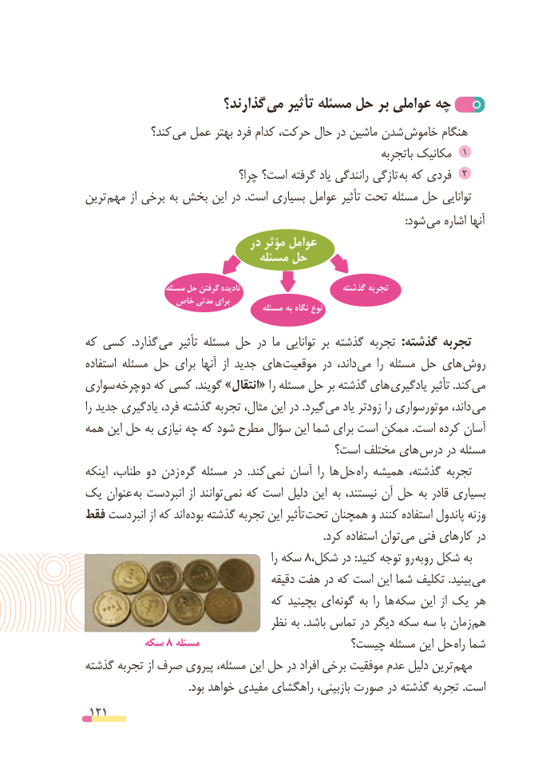

# PDF page 121

گذارند؟ می تأثیر مسئله حل بر عواملی چه
             کند؟ می عمل بهتر فرد کدام حرکت، حال در ماشین شدن خاموش هنگام
                                                                 باتجربه مکانیک  1
                                چرا؟ است؟ گرفته یاد رانندگی تازگی 2به که فردی
ترین مهم از برخی به بخش این در  .است بسیاری عوامل تأثیر تحت مسئله حل توانایی
                          : شود می اشاره آنها
                              در مؤثر عوامل
                              مسئله حل

                     مسئله حل گرفتن نادیده                      گذشته تجربه
               خاص مدتی برای                                           مسئله به نگاه نوع
که کسی  .گذارد می تأثیر مسئله حل در ما توانایی بر گذشته تجربه  :گذشته تجربه
استفاده مسئله حل برای آنها  از جدید های  موقعیت در داند، می  را مسئله حل های روش
سواری  دوچرخه که کسی .گویند »انتقال« را مسئله حل بر گذشته های یادگیری تأثیر .کند  می
را جدید یادگیری فرد، گذشته تجربه مثال، این در .گیرد می یاد زودتر را موتورسواری داند،  می
همه این حل به نیازی چه که شود مطرح سؤال این شما برای است ممکن .است کرده آسان
                                       است؟ مختلف های درس در مسئله
اینکه طناب، دو زدن  گره مسئله در  .کند  نمی آسان  را ها  حل راه همیشه گذشته، تجربه
یک عنوان  به انبردست از توانند نمی که است دلیل این   به نیستند، آن حل  به قادر بسیاری
فقط انبردست از که اند بوده گذشته تجربه این تأثیر  تحت همچنان و کنند استفاده پاندول وزنه
      . کرد استفاده توان می فنی کارهای در
                                                       را سکه 8،روشکل در :کنید توجه     روبه شکل به
                                       دقیقه هفت در که است این شما تکلیف .بینید می
                               که بچینید ای گونه به را ها سکه این از یک هر
                                   نظر به .باشد تماس در دیگر سکه سه با زمان  هم
         سکه 8 مسئله                      چیست؟ مسئله این حل راه شما
گذشته تجربه از صرف پیروی مسئله، این حل در افراد برخی موفقیت عدم دلیل ترین  مهم
                                      .بود خواهد مفیدی راهگشای بازبینی، صورت در گذشته تجربه .است
 121

