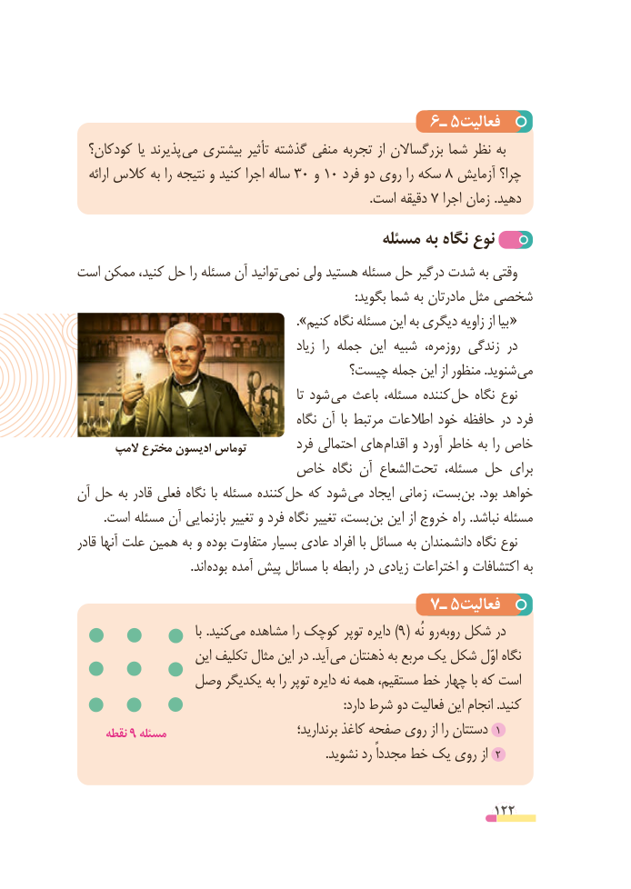

# PDF page 122

6ـ٥فعالیت
  کودکان؟ یا پذیرند می بیشتری تأثیر گذشته منفی تجربه از بزرگساالن شما نظر به
   ارائه کالس به را نتیجه و کنید اجرا ساله 3 0 و 10 فرد دو روی را سکه 8 آزمایش چرا؟
        .7است دقیقه   اجرا زمان .دهید
                                        مسئله به نگاه نوع
است ممکن کنید، حل را مسئله آن توانید  نمی ولی هستید مسئله حل درگیر شدت به وقتی
                                                                                          :بگوید شما به مادرتان مثل شخصی
    ». «کنیم نگاه مسئله این به دیگری زاویه از بیا
                                                زیاد  را جمله این شبیه روزمره، زندگی در
                                   چیست؟ جمله این از منظور .شنوید می
                                                            تا شود می باعث مسئله، کننده  حل نگاه نوع
                                            نگاه آن  با مرتبط اطالعات خود حافظه در فرد
       المپ مخترع ادیسون توماس         فرد احتمالی های  اقدام و آورد خاطر به را خاص
                       خاص نگاه آن الشعاع تحت مسئله، حل برای
آن حل به قادر فعلی نگاه با مسئله کننده حل که شود می ایجاد زمانی بست، بن  .بود خواهد
. است مسئله آن بازنمایی تغییر و فرد نگاه تغییر بست، بن این از خروج راه .نباشد مسئله
قادر آنها علت همین به و بوده متفاوت بسیار عادی افراد با مسائل به دانشمندان نگاه نوع
           . اند بوده آمده پیش مسائل با رابطه در زیادی اختراعات و اکتشافات به
                                      7ـ٥فعالیت
                                   با .کنیدمی )مشاهده را کوچک توپر دایره 9( نُه رو روبه شکل در
                     این تکلیف مثال این در .آید می ذهنتان به مربع یک شکل اوّل نگاه
             وصل یکدیگر به را توپر دایره نه همه مستقیم، خط چهار با که است
                                                                                      :دارد شرط دو فعالیت این انجام .کنید
     نقطه 9 مسئله      برندارید؛١کاغذ صفحه روی از را دستتان
                                                                                .نشوید رد مجدداً خط یک روی از ٢

                                                          122

