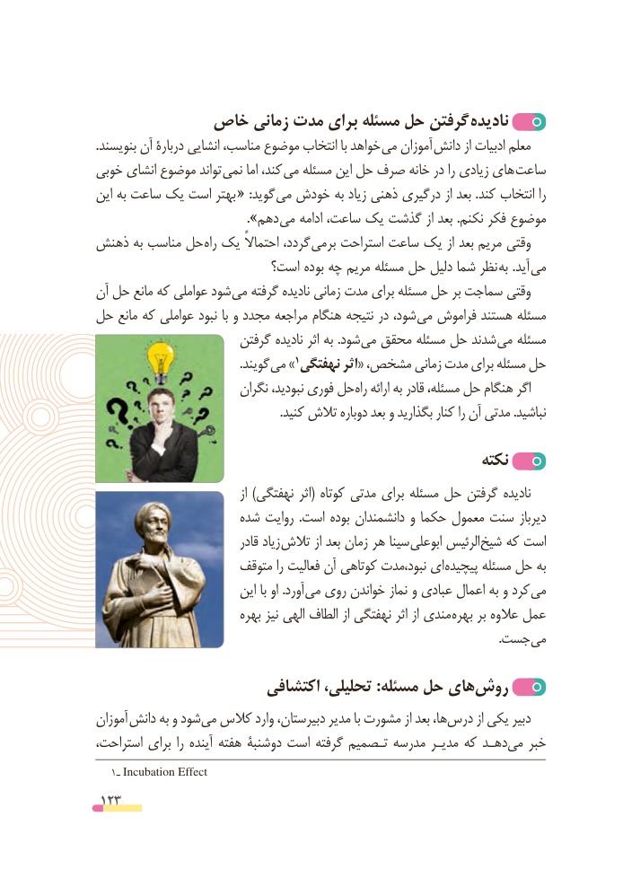

# PDF page 123

خاص زمانی مدت برای مسئله حل گرفتن نادیده
.بنویسند آن دربارة انشایی مناسب، موضوع انتخاب با خواهد می آموزان  دانش از ادبیات معلم
خوبی انشای موضوع تواند  نمی اما کند، می مسئله این حل صرف خانه در را زیادی های ساعت
این به ساعت یک است بهتر  « :گوید می خودش به زیاد ذهنی درگیری از بعد .کند انتخاب را
             ». دهم می ادامه ساعت، یک گذشت از بعد .نکنم فکر موضوع
ذهنش به مناسب حل راه یک احتماالً گردد، برمی استراحت ساعت یک از بعد مریم وقتی
                         است؟ بوده چه مریم مسئله حل دلیل شما نظر به .آید می
آن حل مانع که عواملی شود می گرفته نادیده زمانی مدت برای مسئله حل بر سماجت وقتی
حل مانع که عواملی نبود با و مجدد مراجعه هنگام نتیجه در شود، می فراموش هستند مسئله
                       گرفتن نادیده اثر به .شود می محقق مسئله حل شدند می مسئله
                                               .گویند »می                                        1نهفتگی اثر« مشخص، زمانی مدت برای مسئله حل
                         نگران نبودید، فوری حل راه ارائه به قادر مسئله، حل هنگام اگر
                                                            .کنید تالش دوباره بعد و بگذارید کنار را آن مدتی .نباشید

                                                         نکته
                                       از )نهفتگی اثر( کوتاه مدتی برای مسئله حل گرفتن نادیده
                     شده روایت  .است بوده دانشمندان و حکما معمول سنت دیرباز
                               قادر زیاد تالش از بعد زمان هر سینا ابوعلی الرئیس شیخ که است
                      متوقف را فعالیت آن کوتاهی نبود،مدت ای پیچیده مسئله حل به
                          این با او .آورد می روی خواندن نماز و عبادی اعمال به و کرد می
                           بهره نیز الهی الطاف از نهفتگی اثر از مندی بهره بر عالوه عمل
                       . جست می

                      اکتشافی تحلیلی، :مسئله حل هایروش‌
آموزان  دانش به و شود‌می کالس وارد دبیرستان، مدیر با مشورت از بعد ها،درس‌       از یکی دبیر
استراحت، برای را آینده هفته دوشنبة است گرفته تـصمیم مدرسه مدیـر که دهـدمی‌   خبر
   1ـ Incubation Effect
 123

