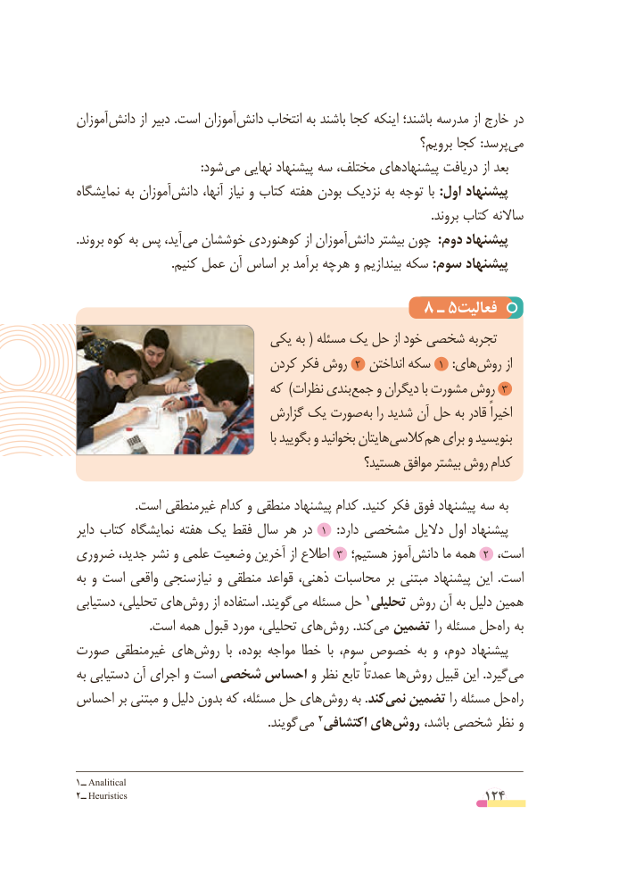

# PDF page 124

آموزان‌دانش از دبیر .است آموزان‌دانش انتخاب به باشند کجا اینکه باشند؛ مدرسه از خارج در
                                                                برویم؟ کجا :پرسد‌می
         : شود می نهایی پیشنهاد سه مختلف، پیشنهادهای دریافت از بعد
نمایشگاه به آموزان ‌دانش آنها، نیاز و کتاب هفته بودن نزدیک به توجه با :اول پیشنهاد
                                                                                                                     .بروند کتاب ساالنه
.‌بروند کوه به پس آید،می ‌خوششان کوهنوردی از آموزان ‌دانش بیشتر چون  :دوم پیشنهاد
                               .کنیم عمل آن اساس بر برآمد هرچه و بیندازیم سکه :سوم پیشنهاد

                                      8 ـ٥فعالیت
                          یکی به ( مسئله یک حل از خود شخصی تجربه
                             کردن فکر روش  2  انداختن سکه  1   :های روش از
                             که )نظرات بندی 3جمع و دیگران با مشورت روش
                             گزارش یک صورت به را شدید آن حل به قادر اخیراً
                                                          با بگویید و بخوانید هایتان کالسی هم برای و بنویسید
                                               هستید؟ موافق بیشتر روش کدام
                   .است غیرمنطقی کدام و منطقی پیشنهاد کدام .کنید فکر فوق پیشنهاد سه به
دایر کتاب نمایشگاه هفته یک فقط سال هر در  1   :دارد مشخصی دالیل اول پیشنهاد
ضروری جدید، نشر و علمی وضعیت آخرین از اطالع 3 هستیم؛ آموز‌2دانش ما همه   ،است
به و است واقعی نیازسنجی و منطقی قواعد ذهنی، محاسبات بر مبتنی پیشنهاد این  .است
دستیابی تحلیلی، های‌روش از استفاده .گویند می مسئله حل                                                             1 تحلیلی ‌روش آن به دلیل همین
 .‌است همه قبول مورد تحلیلی، هایروش .کند‌می تضمین را مسئله حل‌راه به
صورت غیرمنطقی های‌روش  با بوده، مواجه خطا  با سوم، خصوص به و دوم، پیشنهاد
به دستیابی آن اجرای و است شخصی احساس و نظر تابع عمدتاً ها‌روش قبیل این .گیرد‌می
احساس بر مبتنی و دلیل بدون که مسئله، حل هایروش‌     به .کند‌نمی تضمین را مسئله حلراه‌
                                                               .گویند می                                                   2 اکتشافی های‌روش باشد، شخصی نظر و

1ــ Analitical
2ــ Heuristics                                                  124

