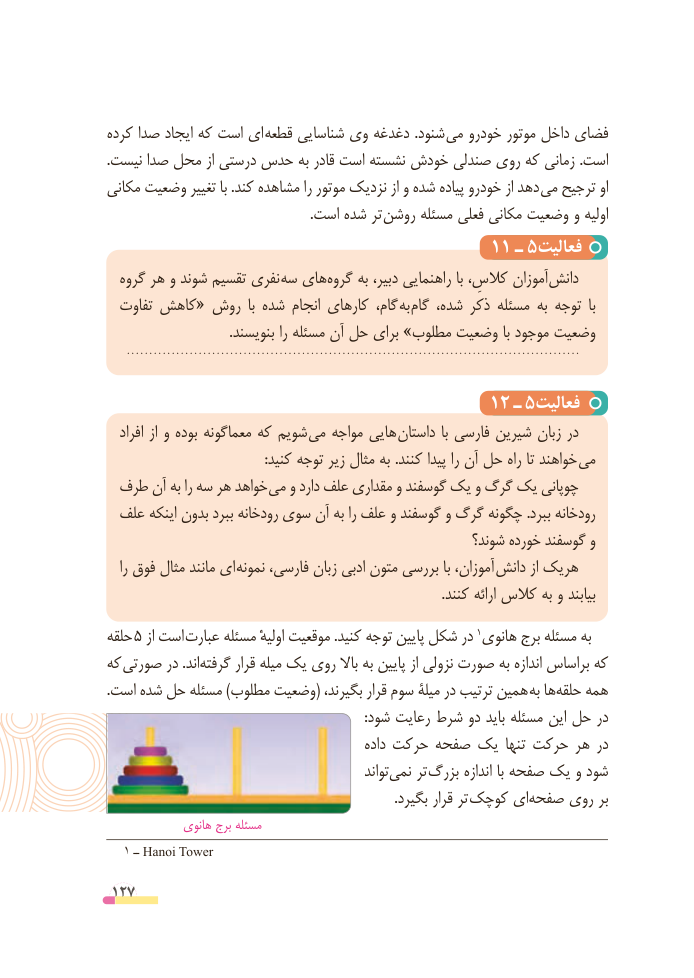

# PDF page 127

کرده صدا ایجاد که است ای  قطعه شناسایی وی دغدغه .شنود می خودرو موتور داخل فضای
.نیست صدا محل از درستی حدس به قادر است نشسته خودش صندلی روی که زمانی .است
مکانی وضعیت تغییر با .کند مشاهده را موتور نزدیک از و شده پیاده خودرو از دهد می ترجیح او
     . است شده تر روشن مسئله فعلی مکانی وضعیت و اولیه
                                     11 ـ 5فعالیت
  گروه هر و شوند تقسیم نفری سه های ‌گروه به دبیر، راهنمایی با کالسِ، آموزان‌دانش
  تفاوت کاهش« روش  با شده انجام کارهای گام، به گام شده، ذکر مسئله به توجه  با
                                    .بنویسند را مسئله آن حل برای »مطلوب وضعیت با موجود وضعیت

                                     12 ـ 5فعالیت
   افراد از و بوده معماگونه که شویم  می مواجه هایی داستان  با فارسی شیرین زبان در
 : کنید توجه زیر مثال به . کنند پیدا را آن حل راه تا خواهند می
 طرف آن به را سه هر خواهد می و دارد علف مقداری و گوسفند یک و گرگ یک چوپانی
  علف اینکه بدون ببرد رودخانه سوی آن به را علف و گوسفند و گرگ چگونه .ببرد رودخانه
                                                        شوند؟ خورده گوسفند و
   را فوق مثال مانند ای نمونه فارسی، زبان ادبی متون بررسی با آموزان،  دانش از هریک
                                                                                                  .کنند ارائه کالس به و بیابند
حلقه 5 از است  عبارت مسئله اولیهٔ موقعیت .کنید توجه پایین شکل در 1هانوی برج مسئله به
که صورتی در .اند‌گرفته قرار میله یک روی باال به پایین از نزولی صورت به اندازه براساس که
.است شده حل مسئله )مطلوب وضعیت( بگیرند، قرار سوم میلة در ترتیب همین  به ها‌حلقه همه
                                                                            :شود رعایت شرط دو باید مسئله این حل در
                                                داده حرکت صفحه یک تنها حرکت هر در
                                                    تواند‌نمی تر بزرگ اندازه با صفحه یک و شود
                                                                                     .بگیرد قرار تر کوچک ایصفحه‌    روی بر
             هانوی برج مسئله
  1 ــ Hanoi Tower

 127

