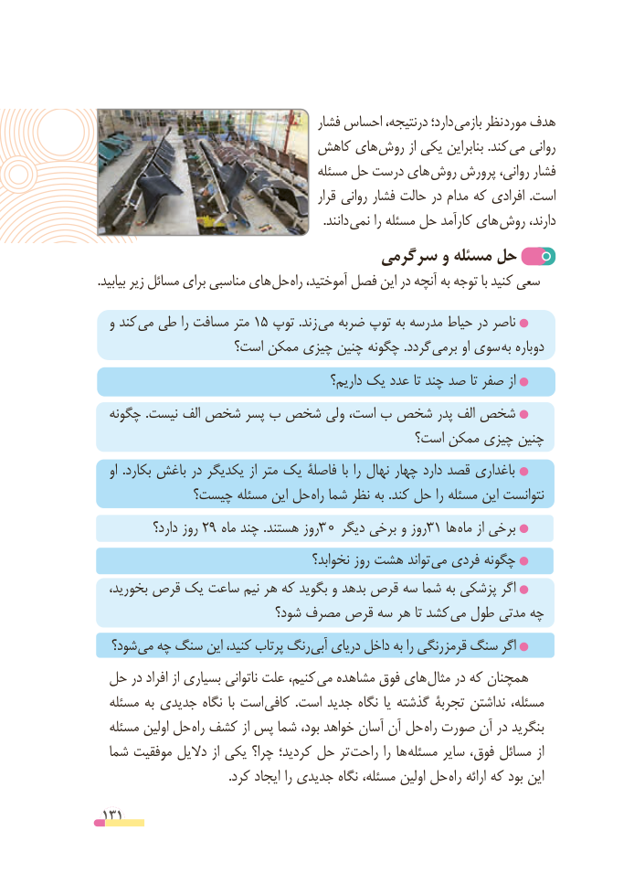

# PDF page 131

فشار احساس درنتیجه، دارد؛ بازمی نظر مورد هدف
                          کاهش های روش از یکی بنابراین .کند می روانی
                                     مسئله حل درست های روش پرورش روانی، فشار
                                                قرار روانی فشار حالت در مدام که افرادی  .است
               . دانند نمی را مسئله حل کارآمد های روش دارند،
                              سرگرمی و مسئله حل
.بیابید زیر مسائل برای مناسبی های حل راه آموختید، فصل این در آنچه به توجه با کنید سعی
  و کند  می١زندطی را مسافت متر  ٥ توپ .     می ضربه توپ به مدرسه حیاط در ناصر
                   است؟ ممکن چیزی چنین چگونه .گردد برمی او سوی به دوباره
                                            داریم؟ یک عدد تا چند صد تا صفر از
  چگونه .نیست الف شخص پسر ب شخص ولی است، ب شخص پدر الف شخص
                                            است؟ ممکن چیزی چنین
   او  .بکارد باغش در یکدیگر از متر یک فاصلۀ با را نهال چهار دارد قصد باغداری
            چیست؟ مسئله این حل راه شما نظر به .کند حل را مسئله این نتوانست
           دارد؟ روز 2 9 ماه چند .هستند روز 30 دیگر برخی و روز31 ها ماه از برخی
                                        نخوابد؟ روز هشت تواند می فردی چگونه
   ،بخورید قرص یک ساعت نیم هر که بگوید و بدهد قرص سه شما به پزشکی اگر
                           شود؟ مصرف قرص سه هر تا کشد می طول مدتی چه
  شود؟ می چه سنگ این کنید، پرتاب رنگ آبی دریای داخل به را رنگی قرمز سنگ اگر
 حل در افراد از بسیاری ناتوانی علت کنیم، می مشاهده فوق های مثال در که همچنان
  مسئله به جدیدی نگاه  با است  کافی  .است جدید نگاه یا گذشته تجربۀ نداشتن مسئله،
  مسئله اولین حل راه کشف از پس شما بود، خواهد آسان آن حل راه صورت آن در بنگرید
  شما موفقیت دالیل از یکی چرا؟ کردید؛ حل تر راحت را ها مسئله سایر فوق، مسائل از
 . کرد ایجاد را جدیدی نگاه مسئله، اولین حل راه ارائه که بود این

 131

