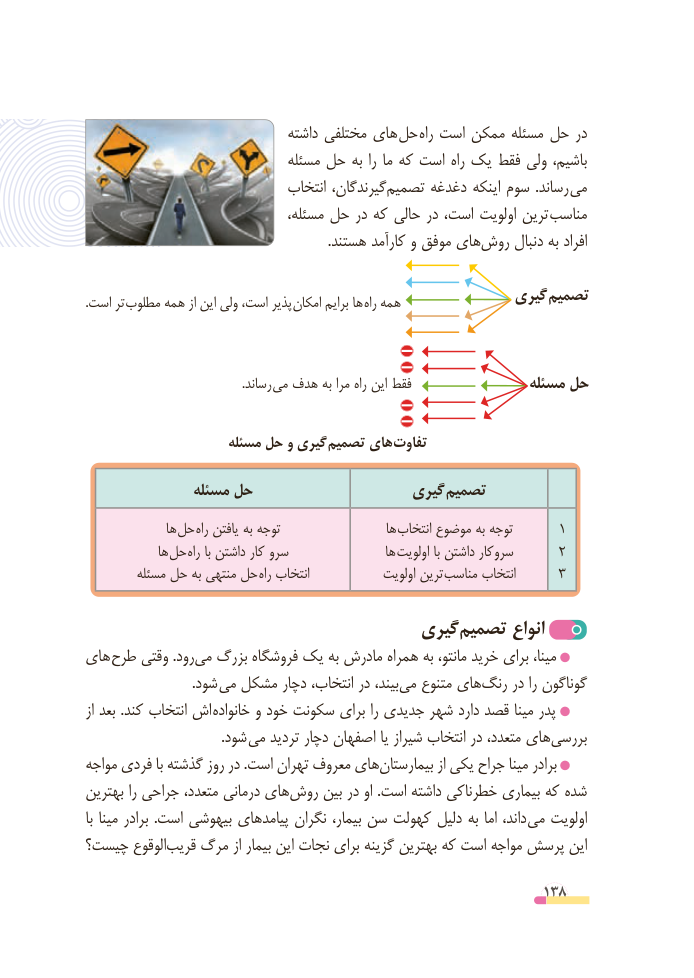

# PDF page 138

داشته مختلفی های حل  راه است ممکن مسئله حل در
                               مسئله حل به را ما که است راه یک فقط ولی باشیم،
                               انتخاب گیرندگان،‌تصمیم ‌دغدغه اینکه سوم  .رساند می
                                 مسئله، حل در که حالی در است، اولویت ترین مناسب
                                                                       .هستند کارآمد و موفق های‌روش دنبال به افراد

                                                    گیری  تصمیم. است تر مطلوب همه از این ولی است، پذیر امکان برایم ها راه همه

         . رساند می هدف به مرا راه این فقط                مسئله حل

                     مسئله حل و گیری تصمیم های تفاوت

               مسئله حل                   گیری تصمیم
               ها حل راه یافتن به توجه                    ها انتخاب موضوع به توجه      1
              ها حل راه با داشتن کار سرو                  ها  اولویت با داشتن سروکار      2
         مسئله حل به منتهی حل راه انتخاب             اولویت ترین مناسب انتخاب      3

                                   گیری‌تصمیم انواع
های طرح وقتی .رود ‌می بزرگ فروشگاه یک به مادرش همراه به مانتو، خرید برای مینا،
                               .شود  می مشکل دچار انتخاب، در بیند،می‌   متنوع های‌رنگ در را گوناگون
از بعد .کند انتخاب اش  خانواده و خود سکونت برای را جدیدی شهر دارد قصد مینا پدر
                                        .شود می تردید دچار اصفهان یا شیراز انتخاب در متعدد، های‌بررسی
مواجه فردی با گذشته روز در .است تهران معروف های ‌بیمارستان از یکی جراح مینا برادر
بهترین را جراحی متعدد، درمانی هایروش‌    بین در او .است داشته خطرناکی بیماری که شده
با مینا برادر  .است بیهوشی پیامدهای نگران بیمار، سن کهولت دلیل به اما داند، می اولویت
چیست؟ الوقوع‌قریب مرگ از بیمار این نجات برای گزینه بهترین که است مواجه پرسش این

                                                          138

