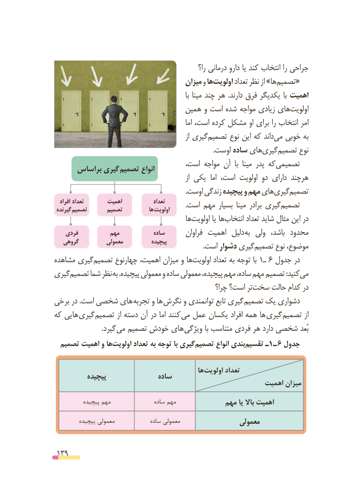

# PDF page 139

را؟ درمانی دارو یا کند انتخاب را جراحی
                                        میزان و هااولویت‌       تعداد نظر از »هاتصمیم‌«
                                                                     با مینا چند هر  .دارند فرق یکدیگر با اهمیت
                                 همین و است شده مواجه زیادی هایاولویت‌
                                                            اما است، کرده مشکل او برای را انتخاب امر
                                                              از گیریتصمیم‌      نوع این که داندمی‌  خوبی به
                                                                                            .اوست ساده هایگیری‌   تصمیم‌      نوع
                                    است، مواجه آن  با  مینا پدر که تصمیمی      براساس گیری تصمیم انواع
                                                               از یکی  اما است، اولویت دو دارای هرچند
                                                                            .اوست زندگی پیچیده و مهم هایگیری‌   تصمیم‌
   افراد تعداد        اهمیت             تعداد            .است مهم بسیار مینا برادر گیریتصمیم‌ گیرنده تصمیم      تصمیم           ها اولویت
                                           هااولویت‌         یا هاانتخاب‌       تعداد شاید مثال این در
    فردی          مهم            ساده       فراوان اهمیت  دلیل به ولی  باشد، محدود
   گروهی          معمولی           پیچیده .‌است دشوار گیریتصمیم نوع موضوع،
مشاهده گیریتصمیم‌      چهارنوع اهمیت، میزان و هااولویت‌       تعداد به توجه با 1ـ 6 جدول در
گیریتصمیم‌     شما نظر به .پیچیده معمولی و ساده معمولی پیچیده، مهم ساده، مهم  تصمیم :کنیدمی‌
                                                      چرا؟ است؟ ترسخت‌     حالت کدام در
برخی در .است شخصی های  تجربه و ها  نگرش و توانمندی تابع گیری تصمیم یک دشواری
که هایی  گیری تصمیم از دسته آن در اما کنند  می عمل یکسان افراد همه ها گیری تصمیم از
      . گیرد می تصمیم خودش های ویژگی با متناسب فردی هر دارد شخصی بُعد
   ‌تصمیم اهمیت و ها ‌اولویت تعداد به توجه با گیری‌تصمیم انواع بندیتقسیم‌     ـ1 ـ 6 جدول

                                                هااولویت‌      تعداد          پیچیده               ساده
                                                        اهمیت میزان
          پیچیده مهم                ساده مهم             مهم یا باال اهمیت
         پیچیده معمولی             ساده معمولی                 معمولی

 139

