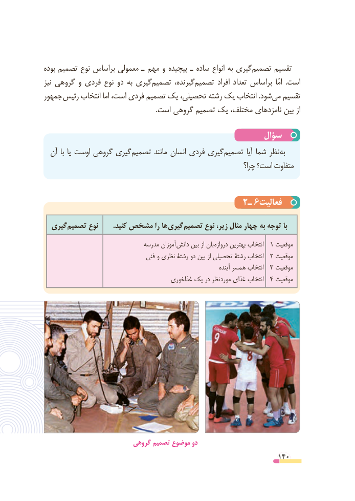

# PDF page 140

بوده تصمیم نوع براساس معمولی ـ مهم و پیچیده ـ ساده انواع به گیریتصمیم‌        ‌تقسیم
نیز گروهی و فردی نوع دو به گیری‌تصمیم گیرنده،‌تصمیم افراد تعداد براساس  امّا  .است
جمهور رئیس انتخاب اما است، فردی ‌تصمیم یک تحصیلی، رشته یک انتخاب .شودمی‌  تقسیم
                                                                .است گروهی تصمیم یک مختلف، نامزدهای بین از

                                                 سؤال
  آن با یا اوست گروهی گیری تصمیم مانند انسان فردی گیری تصمیم آیا شما نظر به
                                                                   چرا؟ است؟ متفاوت

                                      2ـ 6فعالیت

  گیری تصمیم نوع        .کنید مشخص را ها گیری تصمیم نوع ،زیر مثال چهار به توجه با
                                 مدرسه آموزان  دانش بین از بان دروازه بهترین انتخاب  1 موقعیت
                                   فنی و نظری رشتة دو بین از تحصیلی رشتة انتخاب  2 موقعیت
                                                                               آینده همسر انتخاب  3 موقعیت
                                         غذاخوری یک در نظر مورد غذای انتخاب  4 موقعیت

                         گروهی تصمیم موضوع دو
                                                          140

