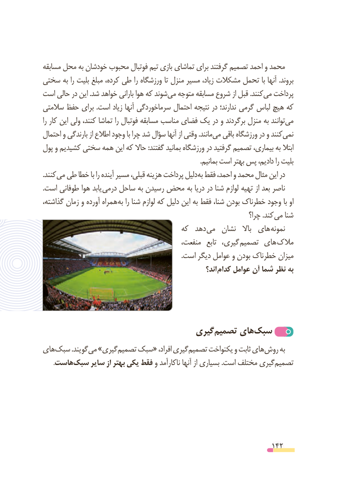

# PDF page 142

مسابقه محل به خودشان محبوب فوتبال تیم بازی تماشای برای گرفتند تصمیم احمد و محمد
سختی به را بلیت مبلغ کرده، طی را ورزشگاه تا منزل مسیر زیاد، مشکالت تحمل با آنها .بروند
است حالی در این .شد خواهد بارانی هوا که شوندمی‌  متوجه مسابقه شروع از قبل .کنندمی‌  پرداخت
سالمتی حفظ برای .است زیاد آنها سرماخوردگی احتمال نتیجه در ندارند؛  گرمی لباس هیچ که
را کار این ولی کنند، تماشا را فوتبال مسابقه مناسب فضای یک در و برگردند منزل به توانندمی‌
احتمال و بارندگی از اطالع وجود با چرا شد سؤال آنها از وقتی .مانندمی‌   باقی ورزشگاه در و کنندنمی‌
پول و کشیدیم سختی همه این که حاال :گفتند بمانید ورزشگاه در گرفتید تصمیم بیماری، به ابتال
                                                                                              .بمانیم است بهتر پس دادیم، را بلیت
. کنند می طی خطا با را آینده مسیر قبلی، هزینه پرداخت دلیل به فقط احمد، و محمد مثال این در
.است طوفانی هوا یابد درمی ساحل به رسیدن محض به دریا در شنا لوازم تهیه از بعد ناصر
گذاشته، زمان و آورده همراه به را شنا لوازم که دلیل این به فقط شنا، بودن خطرناک وجود با او
                                                                     چرا؟ .کند می شنا
                                     که  دهد می  نشان   باال  های نمونه
                                          منفعت،  تابع  گیری، تصمیم های مالک
                                                                                 .است دیگر عوامل و بودن خطرناک میزان
                                                          اند؟ کدام عوامل آن شما نظر به

                                 گیری‌تصمیم های‌سبک
هایسبک‌        .گویندمی‌  »گیریتصمیم‌   سبک« افراد، گیریتصمیم‌     یکنواخت و ثابت هایروش‌     به
 .‌هاستسبک سایر از بهتر یکی فقط و ناکارآمد آنها از بسیاری .است مختلف گیریتصمیم‌

                                                          142

