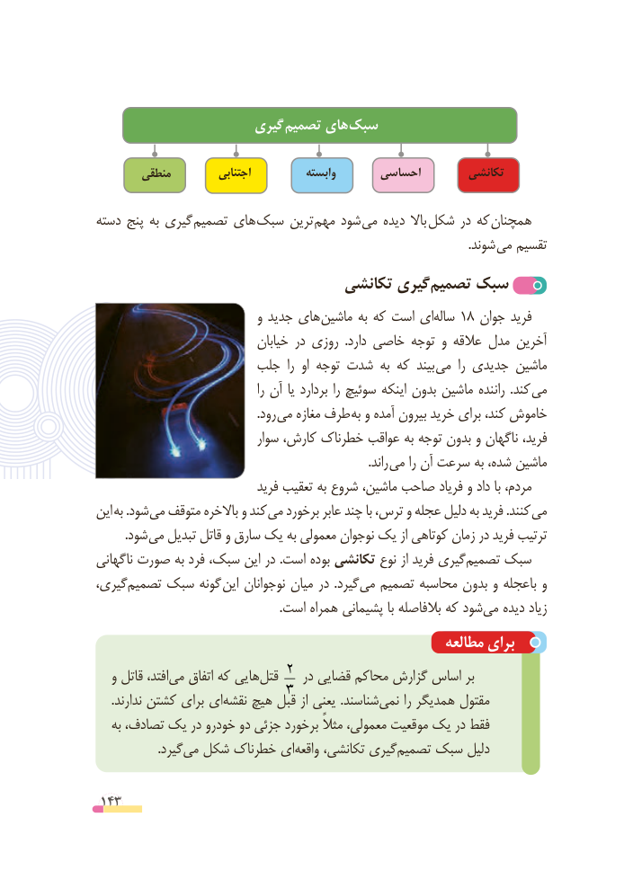

# PDF page 143

گیری تصمیم های سبک

        منطقی          اجتنابی           وابسته       احساسی        تکانشی

دسته پنج به گیری تصمیم های سبک ترین مهم شود  می دیده باال شکل در که همچنان
                        . شوند می تقسیم
                               تکانشی گیری‌تصمیم سبک
                             و جدید های ماشین به که است ایساله‌   18 جوان فرید
                               خیابان در روزی  .دارد خاصی توجه و عالقه مدل آخرین
                     جلب  را  او توجه شدت به که بیند می  را جدیدی ماشین
                                           را آن یا بردارد را سوئیچ اینکه بدون ماشین راننده  .کند می
                                                     .رود می مغازه طرف به و آمده بیرون خرید برای کند، خاموش
                             سوار کارش، خطرناک عواقب به توجه بدون و ناگهان فرید،
                      . راند می را آن سرعت به شده، ماشین
                              فرید تعقیب به شروع ماشین، صاحب فریاد و داد با مردم،
این به .شود می متوقف باالخره و کند می برخورد عابر چند با ترس، و عجله دلیل به فرید .کنند می
  . شود می تبدیل قاتل و سارق یک به معمولی نوجوان یک از کوتاهی زمان در فرید ترتیب
ناگهانی صورت به فرد سبک، این در .است بوده تکانشی نوع از فرید گیریتصمیم‌    سبک
گیری،تصمیم‌    سبک گونه این نوجوانان میان در  .گیردمی‌  تصمیم محاسبه بدون و باعجله و
  .‌است همراه پشیمانی با بالفاصله که شودمی دیده زیاد
                                                      مطالعه برای
   و قاتل افتد،می‌   اتفاق که هایی ‌قتل 2 در قضایی محاکم گزارش اساس بر
     .ندارند کشتن برای ای‌نقشه هیچ قبل3  از یعنی .شناسند‌نمی را همدیگر مقتول
   به تصادف، یک در خودرو دو جزئی برخورد مثالً معمولی، موقعیت یک در فقط
    .‌گیردمی شکل خطرناک ایواقعه‌    تکانشی، گیری‌تصمیم سبک دلیل

 143

