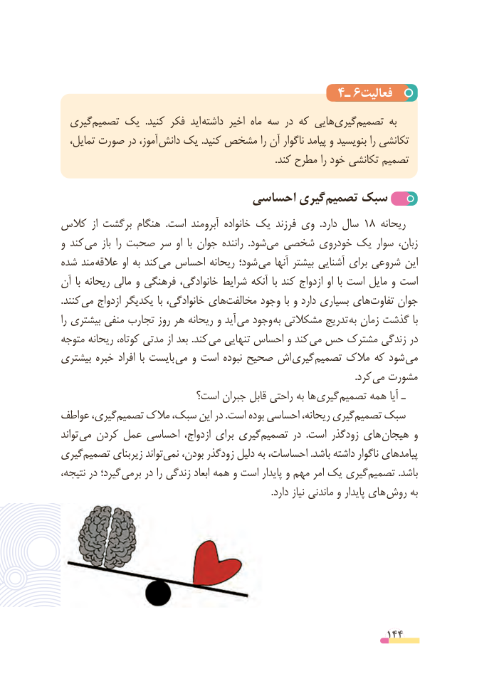

# PDF page 144

4ـ 6فعالیت
  گیری ‌تصمیم یک  .کنید فکر  اید  داشته اخیر ماه سه در که هایی‌گیریتصمیم‌       به
  تمایل، صورت در آموز، دانش یک .کنید مشخص را آن ناگوار پیامد و بنویسید را تکانشی
                                                                                        .کند مطرح را خود تکانشی تصمیم

                          احساسی گیری‌تصمیم سبک
کالس  از برگشت هنگام  .است آبرومند خانواده یک فرزند وی  .دارد سال 18 ریحانه
و کند می باز  را صحبت سر او  با جوان راننده  .شودمی‌  شخصی خودروی یک سوار زبان،
شده مند  عالقه او به کندمی‌  احساس ریحانه شود؛  می آنها بیشتر آشنایی برای شروعی این
آن  با ریحانه مالی و فرهنگی خانوادگی، شرایط آنکه  با کند ازدواج او  با است مایل و است
.کنند  می ازدواج یکدیگر با خانوادگی، های ‌مخالفت وجود با و دارد بسیاری هایتفاوت‌     جوان
را بیشتری منفی تجارب روز هر ریحانه و آید می وجود به مشکالتی تدریج به زمان گذشت با
متوجه ریحانه کوتاه، مدتی از بعد .کند  می تنهایی احساس و کند  می حس مشترک زندگی در
بیشتری خبره افراد  با بایست  می و است نبوده صحیح اش  گیری تصمیم مالک که شود  می
                             . کرد می مشورت
                        است؟ جبران قابل راحتی به ها گیری تصمیم همه آیا ـ
عواطف گیری،‌تصمیم مالک سبک، این در .است بوده احساسی ریحانه، گیری ‌تصمیم سبک
تواند  می کردن عمل احساسی ازدواج، برای گیری‌تصمیم در  .است زودگذر های هیجان و
گیری‌تصمیم زیربنای تواندنمی‌    بودن، زودگذر دلیل به احساسات، .باشد داشته ناگوار پیامدهای
نتیجه، در گیرد؛ برمی در را زندگی ابعاد همه و است پایدار و مهم امر یک گیری‌تصمیم .باشد
    . دارد نیاز ماندنی و پایدار های روش به

                                                          144

