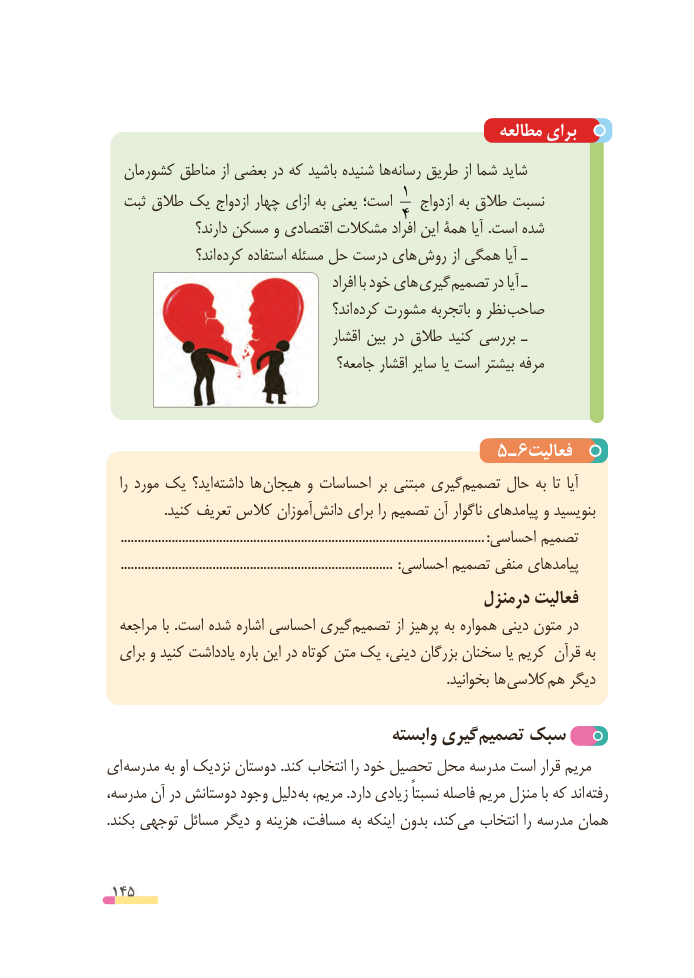

# PDF page 145

مطالعه برای
  کشورمان مناطق از بعضی در که باشید شنیده هارسانه‌    طریق از شما شاید
  ثبت طالق یک ازدواج چهار ازای به یعنی است؛ 1  ازدواج به طالق نسبت
                 دارند؟ مسکن و اقتصادی مشکالت افراد4  این همۀ آیا .است شده
                  اند؟  کرده استفاده مسئله حل درست های روش از همگی آیا ـ
                                               افراد با خود های  گیری تصمیم در آیا ـ
                                             اند؟ کرده مشورت باتجربه و نظر صاحب
                                        اقشار بین در طالق کنید بررسی ـ
                                    جامعه؟ اقشار سایر یا است بیشتر مرفه

                                                  5  ـ 6فعالیت
   را مورد یک اید؟‌داشته ها هیجان و احساسات بر مبتنی گیری‌تصمیم حال به تا آیا
                 .کنید تعریف کالس آموزان‌دانش برای را تصمیم آن ناگوار پیامدهای و بنویسید
    ...........................................................................................................:احساسی تصمیم
    ................................................................................  :احساسی تصمیم منفی پیامدهای
                                                 درمنزل فعالیت
  مراجعه با .است شده اشاره احساسی گیری تصمیم از پرهیز به همواره دینی متون در
  برای و کنید یادداشت باره این در کوتاه متن یک دینی، بزرگان سخنان یا کریم قرآن به
           . بخوانید ها کالسی  هم دیگر

                                      وابسته گیری‌تصمیم سبک‌
ای مدرسه به او نزدیک دوستان .کند انتخاب را خود تحصیل محل مدرسه است قرار مریم
مدرسه، آن در دوستانش وجود دلیل به مریم، .دارد زیادی نسبتاً فاصله مریم منزل با که اند  رفته
.بکند توجهی مسائل دیگر و هزینه مسافت، به اینکه بدون کند، می انتخاب را مدرسه همان

 145

