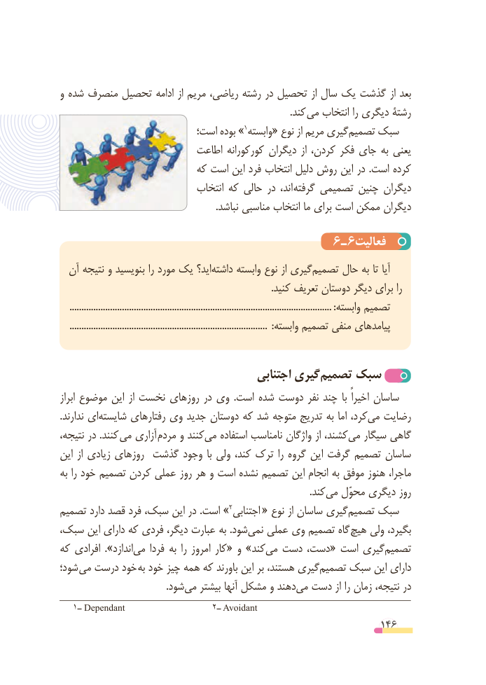

# PDF page 146

و شده منصرف تحصیل ادامه از مریم ریاضی، رشته در تحصیل از سال یک گذشت از بعد
                        . کند می انتخاب را دیگری رشتۀ
                          است؛ بوده »1وابسته« نوع از مریم گیریتصمیم‌    سبک
                          اطاعت کورکورانه دیگران از کردن، فکر جای به یعنی
                          که است این فرد انتخاب دلیل روش این در .است کرده
                              انتخاب که حالی در  اند،  گرفته تصمیمی چنین دیگران
                                                                 .نباشد مناسبی انتخاب ما برای است ممکن دیگران

                                                  6  ـ 6فعالیت
  آن نتیجه و بنویسید را مورد یک اید؟ ‌داشته وابسته نوع از گیری‌تصمیم حال به تا آیا
                                                                                         .کنید تعریف دوستان دیگر برای را
    ..............................................................................................................:وابسته تصمیم
    ...................................................................................  :وابسته تصمیم منفی پیامدهای

                                        اجتنابی گیری‌تصمیم سبک‌
ابراز موضوع این از نخست روزهای در وی  .است شده دوست نفر چند  با اخیراً ساسان
.ندارند ای‌شایسته رفتارهای وی جدید دوستان که شد متوجه تدریج به اما کرد،می‌  رضایت
نتیجه، در .کنند می آزاری  مردم و کنندمی‌   استفاده نامناسب واژگان از کشند،می‌   سیگار گاهی
این از زیادی روزهای گذشت وجود  با ولی کند، ترک را گروه این گرفت تصمیم ساسان
به را خود تصمیم کردن عملی روز هر و است نشده تصمیم این انجام به موفق هنوز ماجرا،
                          .‌کندمی محوّل دیگری روز
تصمیم دارد قصد فرد سبک، این در .است » 2اجتنابی  « نوع از ساسان گیری‌تصمیم سبک
سبک، این دارای که فردی دیگر، عبارت به .شودنمی‌   عملی وی تصمیم گاه هیچ ولی بگیرد،
که افرادی ».اندازد ‌می فردا به را امروز کار« و »کند‌می دست دست،« است گیری‌تصمیم
شود؛ می درست خود به خود چیز همه که باورند این بر هستند، گیری‌تصمیم سبک این دارای
          .‌شودمی بیشتر آنها مشکل و دهندمی‌  دست از را زمان نتیجه، در
   1ــ Dependant                  2ــ Avoidant
                                                          146

